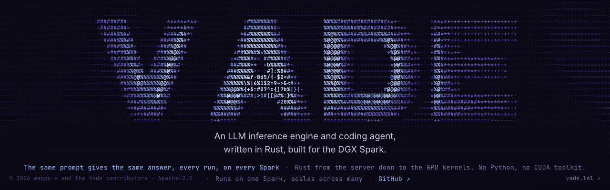

# Vade

<picture>
  <source media="(prefers-reduced-motion: reduce)" srcset="docs/assets/vade-banner-static.png">
  
</picture>

Vade is an inference engine for the NVIDIA DGX Spark. It is written in Rust from the GPU kernels up, and it has zero dependencies. Its one rule is exactness: the same request, with the same settings, gives the same answer every time, and linking Sparks together does not change that.

Install it with one command:

```sh
curl -fsSL https://vade.lol/install.sh | sh
```

Then run `vade up`. The engine is ready for any OpenAI client, and for `vade chat`, a coding agent in your terminal.

<a id="what-it-is"></a>

## What you get

- **Exact answers.** The same request and settings give the same token IDs on every run. You can test this yourself with `vade verify`.
- **Speed from more Sparks.** Link two or four Sparks together and one chat gets faster. The answers stay the same.
- **FP4 and FP8.** Vade runs Qwen3.8 Flash-Next in both formats. FP4-Local fits on one Spark. FP8 needs two or more.
- **An OpenAI-compatible API.** Any OpenAI client works. Claude Code, Codex and other coding tools connect with a short setup. `vade chat` opens Vade's own coding agent.
- **Receipts.** Every row of the benchmark table has its records on GitHub.

<a id="pick-your-path"></a>
<a id="install"></a>
<a id="no-model-yet"></a>

## Quick start

You need a DGX Spark with curl, a driver with CUDA 13.0 or newer, and nothing else using the GPU.

Run these three commands on the Spark. Most of the time goes to the model download.

```sh
curl -fsSL https://vade.lol/install.sh | sh
vade pull nvidia/Qwen3.8-Flash-Next-FP4-Local@b9ce18a6887e18c089fdea8509a33e63429a3300
vade up
```

1. **Install** checks the GPU and the driver, then installs the prebuilt Vade build. It does not need sudo, and it does not change your shell profile. If your shell cannot find `vade` afterwards, run the `export` line that the installer prints.
2. **Pull** downloads the model (102.26 GB) and checks every file. The long hash after `@` pins the exact revision we tested. If the download stops, run the same command again. It continues where it stopped.
3. **Up** starts the engine on this Spark. `vade launch` starts it and opens the coding agent in the current folder. `vade down` stops it.

Next steps:

- Two or four Sparks: [Two and more Sparks](INSTALL.md#two-and-more-sparks).
- FP8: [FP8 install](docs/install-fp8.md).
- A build from a clone, and every setting: [INSTALL.md](INSTALL.md).
- A coding agent is doing the setup for you: give it the [agent quickstart](docs/agents/quickstart.md).

## Use the API

The engine serves the OpenAI protocol on the Spark at port 18080, so the client you already use can talk to it. Point it at `http://127.0.0.1:18080/v1` with any API key.

```python
from openai import OpenAI

client = OpenAI(base_url="http://127.0.0.1:18080/v1", api_key="unused")
reply = client.chat.completions.create(
    model="qwen3.8-flash-next-fp4-local",
    messages=[{"role": "user", "content": "Name the capital of France in one word."}],
    extra_body={"enable_thinking": False},
)
print(reply.choices[0].message.content)
```

The model thinks before it answers unless you turn that off, as this example does. The [OpenAI API](docs/openai-api.md) page lists every endpoint and field. [INSTALL.md](INSTALL.md) shows how to reach the engine from another computer. The [client setup guide](harness/docs/passthrough-matrix.md) walks through Claude Code, Codex, Hermes, OpenCode and Pi.

<a id="benchmark-results"></a>

## Benchmarks

The numbers are tokens per second. Drafting is Vade's speculative decoding: the model's own prediction head guesses a few tokens ahead, and the full model checks each guess. It is on by default, so the first column is what you get out of the box. The middle column shows the same runs with drafting off.

<!-- bench-docs:start -->

<div align="center">

| Setup | One chat | One chat, drafting off | Eight chats at once (total) |
| :---: | :---: | :---: | :---: |
| FP4-Local · 1 Spark | 42.5 | 27.9 | 179.0 |
| FP4-Local · 2 Sparks | 54.9 | 36.0 | 232.2 |
| FP4-Local · 4 Sparks | 63.0 | 42.1 | 245.1 |
| FP8 · 2 Sparks | 37.8 | 27.7 | 98.3 |
| FP8 · 4 Sparks | 51.4 | 37.2 | 131.4 |

</div>

We measured main `1a07e3a` on our own Sparks on the morning of 2026-11-01 for the FP8 rows, and main `dc32b7c` on the morning of 2026-10-31 for the FP4-Local rows. One chat writes prose of up to 8192 tokens. The one-Spark row is the average of two server starts, and every other row is one start. Drafting on means the fixed draft depth 2 that every card uses; the shipped chooser column is coming. The raw record of every run is in the receipts: [FP8](bench/receipts/2026-11-01/README.md) and [FP4-Local](bench/receipts/2026-10-31/README.md).

<!-- bench-docs:end -->

[Results](docs/results.md) has every cell of these runs, with the build, the server commands and the request settings. [Benchmark history](docs/benchmarks.md) keeps every earlier run.

## Exactness

Most inference engines give slightly different answers from one run to the next, and different answers again when you add GPUs. Vade does not.

Exact means the same request with the same settings gives the same token IDs. This holds on every run and on every supported Spark count. It holds for a request alone or in a batch. It holds with or without the prefix cache. For greedy requests, it also holds with drafting on or off.

**Covered today**

- FP4-Local on 1, 2 and 4 Sparks.
- FP8 on 2 and 4 Sparks with the default drafting mode, since 2026-10-31. The pre-merge check matched 66 of 66 replies ([changelog](CHANGELOG.md)).
- Seeds. A request with a fixed `seed` gets the same sampled reply every time. Tested on FP4-Local on 1 and 2 Sparks, with drafting off.

**Not covered yet**

- FP8 on six Sparks.
- The opt-in `fast` and `sampled` draft modes on FP8.
- Seeds with drafting on, on FP8, or on four Sparks.

<a id="defaults-by-route"></a>

**Defaults.** FP4-Local is greedy unless a request sets sampling fields, so it is exact out of the box. FP8 samples by default, with a new seed for each request. For exact FP8 replies, send `temperature` 0, `repetition_penalty` 1, `presence_penalty` 0 and `frequency_penalty` 0 ([FP8 defaults](docs/install-fp8.md#defaults-and-drafting)).

To check your own engine, run `vade verify`. [Token IDs](docs/results.md#token-ids) shows our checks. On main `1a07e3a`, FP8 on two and four Sparks gave the same token IDs ([FP8 token IDs](docs/results.md#fp8-token-ids)). [Architecture](docs/architecture.md#exactness-and-model-quality) gives the full rule and what each check proves.


<a id="supported-systems"></a>
<a id="what-works-today-and-what-doesnt-yet"></a>

## What runs where

- **Model.** Qwen3.8 Flash-Next, text only, at pinned revisions of `nvidia/Qwen3.8-Flash-Next-FP4-Local` and `Qwen/Qwen3.8-Flash-Next-FP8`. To add a model, read [Adding a model](docs/adding-a-model.md).
- **Hardware.** DGX Spark (NVIDIA GB10) on Linux `aarch64`.
- **Sparks.** FP4-Local runs on 1, 2 or 4 Sparks over RDMA, or as a layer chain of 3 to 24 Sparks over TCP. We have measured chains up to four Sparks. FP8 runs on 2 or 4 Sparks. FP8 does not fit on one Spark.
- **Controller.** A controller drives linked Sparks over SSH. It runs on Linux or macOS. From Windows, connect to a Spark and work there ([how](INSTALL.md#from-a-windows-computer)).
- **Coding agent.** The agent reads, searches and edits files anywhere. Its shell tool needs the macOS sandbox, so on the Spark itself it does not run commands.
- **Prefix cache.** On by default on one Spark, on two FP4-Local Sparks and on FP8. Off for FP4-Local on three or more Sparks ([settings](INSTALL.md#the-prefix-cache)).

## Where things are

<div align="center">

| Page | What it is for |
| :---: | :---: |
| [INSTALL.md](INSTALL.md) | The full install, settings and recovery |
| [Agent quickstart](docs/agents/quickstart.md) | Setup steps written for coding agents |
| [FP8 install](docs/install-fp8.md) | FP8 on two or more Sparks |
| [CLI reference](cli/README.md) | Every `vade` command |
| [OpenAI API](docs/openai-api.md) | Endpoints and request fields |
| [Client setup](harness/docs/passthrough-matrix.md) | Claude Code, Codex, Hermes, OpenCode and Pi |
| [Harness](harness/README.md) | The coding agent and its tools |
| [Examples](examples/README.md) | Short scripts against a running engine |
| [Results](docs/results.md) | Every benchmark cell with its settings |
| [Receipts](bench/receipts/2026-10-31/README.md) | The records behind the numbers |
| [Benchmarks](docs/benchmarks.md) | All runs, and how to repeat them |
| [Architecture](docs/architecture.md) | How a request flows, and the exactness rule |
| [Why Vade](docs/why-vade.md) | Why Vade exists |
| [Security](SECURITY.md) | How to report a vulnerability privately |
| [Contributing](CONTRIBUTING.md) | House rules, validation and review |
| [Changelog](CHANGELOG.md) | Changes since v0.1.0 |

</div>

Everything else is in [docs](docs/README.md). Coding agents that change Vade read [AGENTS.md](AGENTS.md) first.

Vade is licensed under [Apache-2.0](LICENSE). The bundled tokenizer and template fixtures keep their own licenses, and so do the models. [NOTICE](NOTICE) lists them. [Credits](CREDITS.md) names the work Vade builds on.
