# Vade

Vade runs a large language model on your own NVIDIA DGX Spark. You get a
coding agent in your terminal, a plain chat and an OpenAI-compatible API.

- **One model today:** `nvidia/Qwen3.8-Flash-Next-FP4-Local`, text only.
- **One Spark or several:** it runs on one Spark by default, and you can link
  more.
- **Exact by design:** the same request on the same setup returns the same
  token IDs on every run, and `vade verify` checks part of that on your own
  engine.
- **Plain Rust:** the Rust code, GPU kernels included, uses no third-party
  crates. Repository tools also use Rust and the standard library.

Latest release: [v0.1.0](https://github.com/wappy-x/vade/releases/tag/v0.1.0),
2026-10-24. The [changelog](CHANGELOG.md) lists what has changed since, under
Unreleased.

<picture>
  <source media="(prefers-reduced-motion: reduce) and (prefers-color-scheme: dark)" srcset="docs/assets/vade-banner-dark-static.svg">
  <source media="(prefers-reduced-motion: reduce)" srcset="docs/assets/vade-banner-light-static.svg">
  <source media="(prefers-color-scheme: dark)" srcset="docs/assets/vade-banner-dark.svg">
  
</picture>

<a id="pick-your-path"></a>
## Install

> [!IMPORTANT]
> **Private preview.** The repository is private for now, so a plain clone
> and the release download links fail without access. Ask the owner for
> access, then follow the private-preview notes in
> [INSTALL step 2](INSTALL.md#step-2-get-the-code).

[INSTALL.md](INSTALL.md) is the full guide.

### One Spark

With the complete 102.26 GB checkpoint already under `~/models`, open a
terminal on an idle DGX Spark and paste this block. You need Git, a C linker
(`cc`), curl and a working NVIDIA driver; INSTALL.md covers missing
prerequisites and downloading the model.

```sh
git clone --branch main https://github.com/wappy-x/vade.git "$HOME/vade" &&
  sh "$HOME/vade/scripts/install.sh" --launch
```

The script installs missing pinned Rust tools, builds Vade, checks this Spark
and the model, then starts the engine and opens chat in the current folder.
It needs no sudo and leaves shell profiles and model files alone. Chat can
edit files where it opens, so ask it only to say hello, then type `/exit`; the
engine keeps running until `vade down`.

In each new shell, put `cargo` and `vade` on your `PATH` first:

```sh
export PATH="$HOME/.cargo/bin:$HOME/vade/cli/target/release:$PATH"
```

The [INSTALL quick start](INSTALL.md#quick-start-with-an-existing-model)
covers an existing checkout, a checkpoint outside `~/models` and what to do if
a step fails. Most of the setup time goes to the first build and the
checkpoint download; we have not timed fresh toolchain and model downloads.

To skip the Rust builds, take the prebuilt launcher bundle and its
`SHA256SUMS` from the
[v0.1.0 release page](https://github.com/wappy-x/vade/releases/tag/v0.1.0);
[INSTALL](INSTALL.md#optional-release-bundle) shows how.

### Two or more Sparks

Linked Sparks are driven from a controller: a Linux or macOS computer (or one
of the Sparks) that reaches each Spark over SSH.

1. On every Spark, do INSTALL.md
   [steps 1 to 3](INSTALL.md#step-1-prerequisites).
2. Cable the Sparks and give each link an address; see
   [hardware and network setup](docs/network-setup.md).
3. Set up the controller with [Route B](INSTALL.md#route-b-from-a-controller),
   then follow [two and more Sparks](INSTALL.md#two-and-more-sparks). The start
   command is `vade up --sparks 2`.

Two Sparks run the tensor split by default, with no settings to set: both
work on every token, so one chat writes faster and a long prompt is read
faster. Four or more Sparks read a long
prompt faster, but one chat does not write faster yet; see
[what works today](#supported-systems).

### From Windows

Windows can't run Vade, but it can drive a Spark. SSH in with the OpenSSH
client that ships with Windows and follow the one-Spark steps there; see
[from a Windows computer](INSTALL.md#from-a-windows-computer).

## What you get

- **Chat in the terminal.** `vade chat` (or `vade launch`) opens Vade's coding
  agent in the folder you start it from. It can read, search and edit files.
  On Linux, the Spark included, it can't run shell commands yet.
- **An OpenAI-compatible API** at `http://127.0.0.1:18080/v1`. It listens
  only on the Spark's loopback; `vade status` prints the address if Vade had
  to pick another port. From another computer, forward the port first:
  `ssh -N -L 18080:127.0.0.1:18080 <user>@<spark>`. From a controller, the API
  is on the `local_port` in your config (18080 unless you changed it).
- **An exactness check.** `vade verify` sends the same requests several times,
  with drafting on and off, checks that the token IDs match and writes
  `vade-verify.json`.
- **A benchmark client.** `vade bench` measures the running engine and writes
  `vade-bench.json`.
- **Commands to look after the engine.** `vade status` says whether it is
  ready, `vade doctor` finds problems in your setup, `vade logs` shows the
  engine log and `vade down` stops what Vade started.

**API requests think first.** Unless a request says otherwise, the model
thinks before it answers, and the thinking counts against the same
`max_tokens` as the answer. To get only the answer, send
`"enable_thinking": false` or `"reasoning_effort": "none"`. `vade chat`,
`vade verify` and `vade bench` turn thinking off for you.

<a id="defaults-by-route"></a>
### Defaults

The [settings guide](INSTALL.md#settings-you-may-change) lists every default
and how to change it. The ones you meet first:

- **Drafting is ON.** The model's multi-token-prediction (MTP) head guesses a
  few tokens ahead and the full model checks each guess, so greedy answers do
  not change.
- **Greedy decoding.** A request with no sampling options always gets the most
  likely next token. Set even one option, such as `"temperature": 0` alone, and
  the engine takes the rest from the checkpoint's settings, which may include
  penalties that change the answer. For greedy answers, send no sampling
  options, or send all of `temperature: 0`, `top_p: 1`, `top_k: 0`,
  `repetition_penalty: 1`, `presence_penalty: 0` and `frequency_penalty: 0`.
- **Context 32768 tokens, output up to 8192.** On the Spark, Vade lowers the
  context (to 16384, then 8192, then 4096) only if the engine refuses it for
  lack of memory, and says so. `--context 262144` requests a larger context;
  we have no published measurement at that size yet. The engine still sets
  the chat count from memory.
- **Chats at once** follow from the context and the memory the engine has.

<a id="supported-systems"></a>
## What works today, and what doesn't yet

- **One model.** `nvidia/Qwen3.8-Flash-Next-FP4-Local` at its pinned publisher
  revision, text only. Two older routes are still in the tree but are not
  supported in v0.1.0: Flash-Next FP8 on two Sparks
  ([legacy install](docs/install-legacy-fp8.md)) and the small Qwen3-8B BF16
  model (`vade run qwen3-8b`, in the
  [legacy quickstart](docs/quickstart-one-spark.md#qwen3-8b-bf16-ubuntu-to-a-first-answer)).
  [Adding a model](docs/adding-a-model.md) says what a new model must pass.
- **DGX Spark only.** The engine runs on DGX Spark (NVIDIA GB10) with Linux
  `aarch64`, and nothing else.
- **Controllers run Linux or macOS.** A controller can run Linux (`aarch64` or
  `x86_64`) or macOS. We tested the full controller lifecycle from macOS, and
  from Linux `aarch64` with a Spark as its own controller. The CLI does not
  build for Windows; from Windows, SSH into the Spark and work there.
- **No shell tool on Linux.** The agent's shell tool and workspace checks need
  the macOS sandbox, so chat on the Spark, or on any Linux computer, can't run
  commands. Reading, searching, line edits and patches work everywhere. On
  macOS, the shell tool sees only system and Homebrew tools; see
  [the controller notes](INSTALL.md#route-b-from-a-controller) if you
  installed Rust with rustup.
- **The agent needs 8192 tokens of context.** Below that, chat on the Spark
  falls back to plain chat, and chat from a controller stops with an error.
- **Two Sparks make one chat faster; four do not yet.** Two Sparks run the
  tensor split by default, with no settings to set: both work on every token.
  In the 2026-10-27 cards, one chat with drafting ON wrote 100.4 and 99.7 tok/s
  of code on two pairs, against 76.7 on one Spark in the v0.1.0 card. Four or
  more Sparks run the layer pipeline: each Spark holds a run of the model's
  layers and passes its work to the next, so one chat uses one GPU at a time,
  and one chat wrote 80.3 tok/s of code on four. More Sparks read prompts
  faster: the first token after a cold 8K prompt came in 2.80 s on two Sparks
  and 2.19 s on four, against 3.86 s on one. See
  [what changed since the 2026-10-26 cards](docs/benchmarks.md#what-changed-since-the-2026-10-26-cards),
  [what the split changes](docs/benchmarks.md#what-the-split-changes) and
  [reading these cards](docs/benchmarks.md#reading-these-cards).
- **Eight chats without drafting are slower on two Sparks than before.** With
  drafting OFF, eight chats reached 111.6 and 110.8 tok/s on the split in the
  2026-10-27 cards, against 137.0 on the layer pipeline in the 2026-10-26
  cards. Drafting is on by default; with it, eight chats reached 221.8 and
  221.6 against 201.7.
- **On four Sparks, eight chats ran without drafting.** In the four-Spark
  card the engine served every eight-chat response without drafting, so eight
  chats with drafting ON reached 136.5 tok/s, against 176.4 on two.
- **Chains are measured up to four machines.** The
  [FP4-Local guide](cli/docs/fp4-local.md) describes chains of 2 to 24 Sparks.
  We have run at most four: four DGX Sparks at `6cb46bf` on 2026-10-25, and
  four cloud GB10 VMs at v0.1.0 on 2026-10-24.
- **The prefix cache is opt-in and one-Spark only.** It lets a request that
  starts like an earlier one skip reading that start again. See
  [turn on the prefix cache](INSTALL.md#turn-on-the-prefix-cache).

## Exactness

The rule: the same request on the same setup (build, checkpoint, number of
Sparks and settings) gives identical token IDs on every run and every Spark.
That holds whether the request runs alone or batched, whether or not it hits
the cache, and, with greedy decoding, with drafting ON or OFF.

`vade verify` checks the drafting part on your own engine. A pass prints
`IDENTICAL: 20/20 runs, 1 machine, N tokens`, where N is the reply's length in
tokens. It covers the requests it sent, not every mix of batching and caching.

What we have checked so far covers drafting ON against OFF:

- On main `12142bb` (2026-10-27), the two-Spark tensor-split cards matched
  drafting ON against OFF in 66 of 66 responses on each of two pairs. The
  pairs also matched each other and the 2026-10-26 cards
  ([benchmarks](docs/benchmarks.md#current-2026-10-27-main-12142bb-home-dgx-sparks)).
- On the v0.1.0 release build (`5a22651`), the one-Spark drafting-ON card
  matched the drafting-OFF card in 66 of 66 responses, and `vade verify`
  printed `IDENTICAL: 20/20 runs, 1 machine, 128 tokens`
  ([receipt](bench/receipts/2026-10-24/2026-10-24_1943_qwen3.8-flash-next-nvfp4_local-1spark_5a22651-drafting-on-thinking-off/README.txt)).
- On an earlier build (`4681d8b`), two Sparks matched drafting ON and OFF in
  201 of 201 request pairs
  ([receipt](bench/receipts/2026-10-24/2026-10-24_0711_qwen3.8-flash-next-nvfp4_local-2spark_4681d8b-drafting-on-thinking-off/README.txt)).

These receipts do not test alone against batched, or a cache hit against a
miss. [Exactness and model quality](docs/architecture.md#exactness-and-model-quality)
explains the full rule and what each check proves.

## Use our agent, add our gateway, or bring your own client

- **Our agent.** `vade chat` opens Vade's agent on the running engine.
- **Our gateway in front of your client.** `vade-gateway` sits between the
  client you already use and the engine, on `http://127.0.0.1:8787/v1`; see
  [the client gateway](INSTALL.md#client-gateway).
- **Your own client.** Point any OpenAI-compatible client at
  `http://127.0.0.1:18080/v1`. The
  [client setup guide](harness/docs/passthrough-matrix.md) covers Codex,
  Hermes, OpenCode and Pi, directly or through the gateway.

## Measured results

<!-- bench-docs:start -->

### Latest measured main

| Model | Sparks | Path | Drafting | Prose | Code | Structured | C1 | C4 | C8 | Cold 8K (s) | IDs saved / responses |
| --- | ---: | --- | --- | ---: | ---: | ---: | ---: | ---: | ---: | ---: | ---: |
| qwen3.8-flash-next-fp4-local | 2 | tensor split | OFF | 29.719 | 29.579 | 29.776 | 28.829 | 75.333 | 110.818 | 2.77 | 66/66 |
| qwen3.8-flash-next-fp4-local | 2 | tensor split | ON | 53.503 | 99.737 | 129.74 | 75.249 | 164.802 | 221.582 | 2.799 | 66/66 |

Measured main revision: `12142bb551abd960448135f3e75953d518fb77fa`.

2 Sparks, tensor split, drafting OFF: finished `2026-10-27T12:53:33.568612+00:00`; card SHA256 `00ec2d26de0584ff53de605f288b53c0f1b89231777b88b60d7158ba3a073304`.

2 Sparks, tensor split, drafting ON: finished `2026-10-27T12:41:38.391950+00:00`; card SHA256 `f91c43bd13cab79fb2b788556f3fbc64b3a311a367f1fb06062ab9f777fa8c6e`.

Rates are card medians in tok/s. C1, C4 and C8 cover all chats together.
Cold 8K is the median time to the first token. IDs saved counts responses
with recorded token IDs. This count does not prove that the IDs match.

Only the newest measured revision in main's first-parent history appears.
Each row uses the last finished, complete, passing, thinking-OFF card for
its Spark count, path and drafting setting. Older revisions do not fill gaps.

From the repository root, refresh both tables with this command.
Replace the quoted path with the folder that holds the cards.

```sh
cargo +1.99.0 run --offline --locked --manifest-path tools/Cargo.toml -p vade-tools -- bench-docs '<cards-dir>' .
```

The sections below are historical results. Their dates and revision names
apply only to those measurements.

<!-- bench-docs:end -->

[RigMark](docs/benchmarks.md#run-rigmark-against-vade) is a public benchmark,
and a card is the recorded result of one run. A receipt is the saved record of
a run, and every number here comes from one. The
[benchmarks page](docs/benchmarks.md) has every card, the full recipe and the
caveats.

### Two Sparks, 2026-10-27

`vade up --sparks 2` runs the tensor split by default. You set nothing. These
RigMark cards ran on two pairs of our DGX Sparks on 2026-10-27, at main
`12142bb`, with no split settings in the environment, drafting ON (the
default), context 32768, greedy decoding and thinking OFF. They measure the
same speeds as the 2026-10-26 cards below, where the split's four levels were
still set by hand, and their token IDs match those cards in 66 of 66
responses.

| Two DGX Sparks | Prose tok/s | Code tok/s | Structured tok/s | 1 chat tok/s | 4 chats tok/s | 8 chats tok/s | First token, cold 8192-token prompt (s) |
| --- | ---: | ---: | ---: | ---: | ---: | ---: | ---: |
| Tensor split (the default), home-1 + home-2 | 53.9 | 100.4 | 130.3 | 76.9 | 165.7 | 221.8 | 2.80 |
| Tensor split (the default), home-3 + home-4 | 53.5 | 99.7 | 129.7 | 75.2 | 164.8 | 221.6 | 2.80 |

Prose, code and structured are one chat at a time, 5 runs each with an
8192-token cap. The 1-, 4- and 8-chat rates cover all chats together, 3 rounds
with a 256-token cap. Structured output is a predictable JSON workload, not a
measure of general agent performance.

Long prompts reach their first token sooner than they did on the 2026-10-26
builds, for two reasons. The first token no longer waits while the two Sparks
swap a long prompt's layer state, and that swap now goes GPU to GPU over the
RDMA link (#114). And the first Spark now reads the second Spark's
prompt-tile replies as they arrive, so a long prompt from a chat that drafts
no longer stalls in the middle of the read (#120). On a second start with
context 69632, a 32,099-token prompt reached its first token in 10.10 s on
the first pair and 10.24 s on the second; a 64,217-token prompt took 21.54 s
and 21.60 s. The drafting-OFF cards and the full tables are on the
[benchmarks page](docs/benchmarks.md#current-2026-10-27-main-12142bb-home-dgx-sparks).

### Two Sparks, 2026-10-26

`vade up --sparks 2` runs the tensor split. These RigMark cards ran on two of
our DGX Sparks on 2026-10-26, drafting ON (the default), context 32768,
greedy decoding and thinking OFF. The split row is main `262b0c3` with the
split's four levels set by hand, the same four that are now the default. The
pipeline row is the path two Sparks ran before, measured on main `99e8f62`
the same afternoon; `VADE_W2_PATH=pipeline` still selects it, for a short
time.

| Two DGX Sparks | Prose tok/s | Code tok/s | Structured tok/s | 1 chat tok/s | 4 chats tok/s | 8 chats tok/s | First token, cold 8192-token prompt (s) |
| --- | ---: | ---: | ---: | ---: | ---: | ---: | ---: |
| Tensor split (the default) | 54.2 | 100.9 | 130.4 | 76.8 | 161.4 | 220.0 | 2.81 |
| Layer pipeline (before) | 42.2 | 80.3 | 100.8 | 61.9 | 143.2 | 201.7 | 2.78 |

Prose, code and structured are one chat at a time, 5 runs each with an
8192-token cap. The 1-, 4- and 8-chat rates cover all chats together, 3 rounds
with a 256-token cap. Structured output is a predictable JSON workload, not a
measure of general agent performance. The drafting-OFF cards and a second pair
are on the [benchmarks page](docs/benchmarks.md#previous-2026-10-26-main-262b0c3-home-dgx-sparks).

### The v0.1.0 release, 2026-10-24

These are the RigMark cards for the v0.1.0 release (commit `5a22651`),
measured on 2026-10-24, when two Sparks ran the layer pipeline.

<picture>
  <source media="(prefers-color-scheme: dark)" srcset="docs/assets/benchmarks-2026-10-24-dark.svg">
  
</picture>

The chart compares one of our Sparks with two, drafting ON.
`cargo +1.99.0 run --offline --locked --manifest-path tools/Cargo.toml -p vade-tools -- benchmarks-chart` redraws it from the
[2026-10-24 receipts](bench/receipts/2026-10-24/README.md). The table adds
drafting OFF and the cloud VMs.

How to read it:

- Every card used context 32768, greedy decoding and thinking OFF. In the OFF
  rows, every request sent `"draft":"plain"`.
- Code and prose are one chat at a time, 5 runs each with an 8192-token cap.
  The 8-chat rate covers all eight chats together, 3 rounds with a 256-token
  cap, so 24 streams in all; the table says how many of them the engine served
  without drafting. The first-token time is after a cold 8192-token prompt, 3
  runs.
- Tok/s is completion tokens per second of wall-clock time.
  [Client time and server time](docs/benchmarks.md#client-time-and-server-time)
  explains where that clock can start.
- We have not run another engine on this checkpoint, so this is not a
  head-to-head comparison.

| Setup | Drafting | Code tok/s | Prose tok/s | 8 chats tok/s | 8-chat streams served without drafting | First token, cold 8192-token prompt (s) |
| --- | --- | ---: | ---: | ---: | ---: | ---: |
| One DGX Spark | OFF | 27.8 | 27.8 | 136.1 | all (OFF) | 3.82 |
| One DGX Spark | ON | 76.7 | 41.7 | 173.9 | 10/24 | 3.86 |
| Two DGX Sparks | OFF | 27.9 | 27.9 | 135.1 | all (OFF) | 2.80 |
| Two DGX Sparks | ON | 65.1 | 38.3 | 168.6 | 12/24 | 2.79 |
| One cloud GB10 VM | OFF | 24.4 | 22.5 | 73.3 | all (OFF) | 3.99 |
| One cloud GB10 VM | ON | 61.1 | 31.6 | 97.5 | 10/24 | 3.98 |
| Two cloud GB10 VMs | OFF | 24.4 | 22.9 | 112.2 | all (OFF) | 2.95 |
| Two cloud GB10 VMs | ON | 54.7 | 30.5 | 138.3 | 11/24 | 2.95 |
| Four cloud GB10 VMs | OFF | 21.9 | 20.7 | 104.2 | all (OFF) | 2.38 |
| Four cloud GB10 VMs | ON | 51.6 | 29.0 | 104.2 | 24/24 | 2.42 |

What stands out:

- **One chat runs at the same speed on every Spark we tried.** On six of our
  Sparks, one at a time, drafting OFF gave 27.6 to 27.8 tok/s on prose and
  27.7 to 27.8 on code; drafting ON gave 41.3 to 41.7 on prose and 76.1 to
  76.7 on code.
- **The 8-chat rate moves more.** Under that load the engine serves some chats
  without drafting, so with drafting ON it ranged from 130.6 to 173.9 tok/s
  across the six Sparks; the one-Spark ON row is the top of that range. One
  drafting-OFF run on one of the six landed at 86.6
  ([receipt](bench/receipts/2026-10-24/2026-10-24_1941_qwen3.8-flash-next-nvfp4_local-1spark_5a22651-drafting-off-thinking-off-home-6/)),
  a drop we have not reproduced or explained.
- **Four cloud VMs did not make one chat faster.** They run as one engine,
  each VM holding a slice of the layers. A chain is meant for models too big
  for one machine. In its drafting-ON run the engine served all eight chats
  without drafting, so both four-VM rows show the same 8-chat rate.

Each row has its own receipt, named by the time of its run:

- One DGX Spark: [OFF (1937)](bench/receipts/2026-10-24/2026-10-24_1937_qwen3.8-flash-next-nvfp4_local-1spark_5a22651-drafting-off-thinking-off/), [ON (1943)](bench/receipts/2026-10-24/2026-10-24_1943_qwen3.8-flash-next-nvfp4_local-1spark_5a22651-drafting-on-thinking-off/)
- Two DGX Sparks: [OFF (2012)](bench/receipts/2026-10-24/2026-10-24_2012_qwen3.8-flash-next-nvfp4_local-2spark_5a22651-drafting-off-thinking-off/), [ON (2019)](bench/receipts/2026-10-24/2026-10-24_2019_qwen3.8-flash-next-nvfp4_local-2spark_5a22651-drafting-on-thinking-off/)
- One cloud GB10 VM: [OFF (1946)](bench/receipts/2026-10-24/2026-10-24_1946_qwen3.8-flash-next-nvfp4_local-1spark_5a22651-drafting-off-thinking-off-cloud-a-vma/), [ON (1954)](bench/receipts/2026-10-24/2026-10-24_1954_qwen3.8-flash-next-nvfp4_local-1spark_5a22651-drafting-on-thinking-off-cloud-a-vma/)
- Two cloud GB10 VMs: [OFF (2027)](bench/receipts/2026-10-24/2026-10-24_2027_qwen3.8-flash-next-nvfp4_local-2spark_5a22651-drafting-off-thinking-off-cloud-a/), [ON (2035)](bench/receipts/2026-10-24/2026-10-24_2035_qwen3.8-flash-next-nvfp4_local-2spark_5a22651-drafting-on-thinking-off-cloud-a/)
- Four cloud GB10 VMs: [OFF (2204)](bench/receipts/2026-10-24/2026-10-24_2204_qwen3.8-flash-next-nvfp4_local-4spark_5a22651-drafting-off-thinking-off-cloud-a/), [ON (2213)](bench/receipts/2026-10-24/2026-10-24_2213_qwen3.8-flash-next-nvfp4_local-4spark_5a22651-drafting-on-thinking-off-cloud-a/)

Raw benchmark output stays private until it has been reviewed for publication;
[the receipts list](bench/receipts/README.md) says what is public.

## License

Vade's code is licensed under [Apache-2.0](LICENSE). The bundled tokenizer and
template fixtures keep their upstream licenses, the
[Code of Conduct](CODE_OF_CONDUCT.md) uses CC BY 4.0, and models keep their own
licenses. [NOTICE](NOTICE) lists the shipped files and their license texts,
and [Credits](CREDITS.md) keeps the source attribution.

## Documentation map

| Guide | What it covers |
| --- | --- |
| [INSTALL.md](INSTALL.md) | The whole install, starting with one Spark |
| [First run](harness/docs/first-run.md) | The launcher on your Spark, saved settings and later runs |
| [CLI reference](cli/README.md) | Commands, configuration and recovery |
| [Examples](examples/README.md) | Short examples you can run: curl, a Rust API client, Claude Code, Codex, vade bench and a two-Spark launch |
| [Benchmarks](docs/benchmarks.md) | Measured results, receipts and how to reproduce them |
| [Architecture](docs/architecture.md) | How requests reach the engine, and the exactness rule |
| [Glossary](docs/GLOSSARY.md) | The serving terms these docs use |
| [Harness](harness/README.md) | The coding agent, its tools, and the gateway for other clients |
| [Engine docs](engine/docs/README.md) | How the engine runs, its GPU kernels and how it is validated |
| [All documentation](docs/README.md) | Guides for deploying and developing Vade |
| [Contributing](CONTRIBUTING.md) and [agent rules](AGENTS.md) | How to change Vade: house rules, validation and review |
| [Security](SECURITY.md) | How to report a vulnerability privately |
