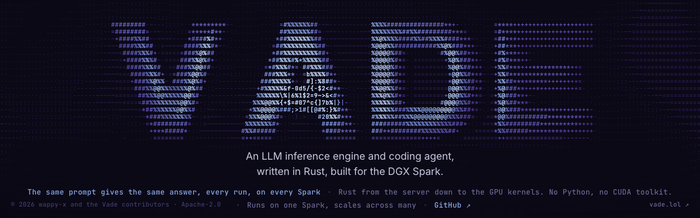

# Vade

<picture>
  <source media="(prefers-reduced-motion: reduce)" srcset="docs/assets/vade-banner-static.png">
  
</picture>

Vade is an inference engine for the NVIDIA DGX Spark. It is written in Rust from the GPU kernels up, with zero third-party crates. Its one rule is exactness: the same request with the same settings returns the same token IDs every time, across runs and across supported Spark counts.

The GPU kernels compile to PTX (NVIDIA's portable GPU assembly) and use short inline PTX for the few instructions that have no Rust spelling. The installer and Spark setup helpers are shell scripts. At run time, Vade needs only the NVIDIA driver. The installer also needs `curl`. A build from source also needs a C compiler (`cc`) and Rust.

One command installs Vade. One command pulls the model (102 GB). One command starts the engine.

```sh
curl -fsSL https://vade.lol/install.sh | sh
```

Check the script before you run it with its SHA-256 at https://dl.vade.lol/install.sh.sha256.

Next, pull the model with `vade pull nvidia/Qwen3.8-Flash-Next-FP4-Local@b9ce18a6887e18c089fdea8509a33e63429a3300` and start it with `vade up`. [Quick start](#quick-start) lists all three commands. The engine serves any OpenAI client and `vade chat`, Vade's built-in terminal coding agent.

<a id="models"></a>

## Models

<div align="center">

| Model | Sparks | Status | Start it with |
| :--- | :---: | :--- | :--- |
| Qwen3.8 Flash-Next FP4-Local | 1, 2 or 4 | Supported, exact | `vade up` |
| Qwen3.8 Flash-Next FP8 | 2 or 4 | Supported, exact | `vade up --fp8` (controller) |
| GLM 5.3 Flash FP4-Local | 2 | Diagnostic text service, not qualified | `vade up --sparks 2 --diagnostic-unqualified-text` (controller) |
| Inkling 2 Mini | 1 | Text-only preview, not qualified | `VADE_MODELS=<folder> vade up` |

</div>

Qwen3.8 Flash-Next is the supported product. GLM 5.3 Flash and Inkling 2 Mini run text only, are not qualified yet, and their speed and limits can still change. [Other models](#other-models) shows how to pull and start them.

<a id="what-it-is"></a>

## What you get

- **Exact answers.** The same request and settings return identical token IDs on every run. Test your own engine with `vade verify`.
- **Speed from linked Sparks.** Link two or four Sparks and one chat runs faster without changing the token IDs.
- **FP4 and FP8.** Vade runs Qwen3.8 Flash-Next in both formats. FP4-Local fits on one Spark. FP8 needs two or more.
- **OpenAI-compatible API and coding agent.** Any OpenAI client works. Claude Code, Codex and other coding tools connect with a short setup. `vade chat` opens Vade's own coding agent.
- **Receipts.** [Results](docs/results.md) names the build, settings and record behind every number.

<a id="pick-your-path"></a>
<a id="install"></a>
<a id="no-model-yet"></a>

## Quick start

You need a DGX Spark with `curl`, an NVIDIA driver with CUDA 13.0 or newer, an idle GPU, and 112 GB of free disk. A build from source also needs a C compiler (`cc`).

Run these three commands on the Spark. Allow time for the download and the first full model check.

```sh
curl -fsSL https://vade.lol/install.sh | sh
vade pull nvidia/Qwen3.8-Flash-Next-FP4-Local@b9ce18a6887e18c089fdea8509a33e63429a3300
vade up
```

1. **Install.** Checks the GPU and driver, then installs the prebuilt Vade bundle into `~/.vade`. It needs no sudo and does not edit your shell profile. Follow its PATH advice before the next command: when a login shell finds Vade, it prints `Open a new terminal, then run: vade up`. Otherwise, run its `export PATH="$HOME/.vade/bin:$PATH"` line.
2. **Pull.** Downloads the model (102.26 GB, 32 files) and checks every file. The hash after `@` pins the tested revision. If the download stops, run the same command again to resume.
3. **Up.** Starts the engine on this Spark. Use `vade launch` to start it and open the coding agent in the current folder. On the Spark, the agent reads, searches and edits files, but does not run shell commands. Use `vade down` to stop the engine.

The chat hint uses `vade launch` when a login shell finds Vade, `~/.vade/bin/vade launch` otherwise, or your custom `VADE_HOME` path.

**First-run time.** On rented GB10 VMs, the download took about 80 minutes to over three hours ([download record](docs/benchmarks.md#rented-cloud-gb10-vms)). With the model on disk, the first full file check on a pair of Sparks took 74.2 s and 77.9 s, and `vade up` after install took 27.0 s ([install record for build 5a22651](bench/receipts/2026-10-24/2026-10-24_2014_qwen3.8-flash-next-nvfp4_local-2spark_5a22651-drafting-off-thinking-off/README.txt)). Each Spark keeps a check record so later starts reuse it ([first-run time and records](docs/INSTALL.md#first-run-time-and-records)).

Next steps:

- Two or four Sparks: [Two and more Sparks](docs/INSTALL.md#two-and-more-sparks).
- FP8: [FP8 install](docs/install-fp8.md).
- Source build and every setting: [INSTALL.md](docs/INSTALL.md).
- One-page checklist with check and uninstall commands: [Quickstart](docs/quickstart.md).
- Setup by a coding agent: [install page for agents](docs/agents/install.md) and [agent quickstart](docs/agents/quickstart.md).

<a id="other-models"></a>

### Other models

Both models below run text only and are not qualified yet. [GLM and Inkling](docs/INSTALL.md#glm-and-inkling-2-mini) gives every step and limit.

**Inkling 2 Mini on one Spark:**

```sh
vade pull thinkingmachines/Inkling-2-Mini@b85c3cfa615fc413cc9af3379f491b963f3b586a
VADE_MODELS=~/models/thinkingmachines/Inkling-2-Mini vade up
```

On current `main`, Inkling keeps 20.69 GB of resident weights, admits 37–38 concurrent chats with `--mtp 7` (44 plain) at 32K context, accepts configured contexts up to 1,048,576 tokens, and keeps the prompt cache on by default (`--cache-bytes 0` turns it off). `vade up` defaults to plain decode (`--mtp 0`) and accepts explicit `--mtp 0..=7` up to the checkpoint's declared draft depth.

**GLM 5.3 Flash on two Sparks.** Pull it on both Sparks, set the controller config to that folder and revision, then start it from the controller:

```sh
vade pull nvidia/GLM-5.3-Flash-FP4-Local@76348ddb2be2e35e39ecfc00e75dc07703f4f3d5
vade up --sparks 2 --diagnostic-unqualified-text
```

## Use the API

The engine serves the OpenAI protocol on the Spark at `http://127.0.0.1:18080/v1` with any API key. If port 18080 was busy at first start, Vade picks another free port and saves it; run `vade status` to print the address.

```python
from openai import OpenAI

client = OpenAI(base_url="http://127.0.0.1:18080/v1", api_key="unused")
reply = client.chat.completions.create(
    model="qwen3.8-flash-next-fp4-local",
    messages=[{"role": "user", "content": "Name the capital of France in one word."}],
    extra_body={"enable_thinking": False},
)
print(reply.choices[0].message.content)
```

The model thinks before it answers unless you turn thinking off, as shown above. See [OpenAI API](docs/openai-api.md) for every route and field. The engine listens on loopback only; [INSTALL.md](docs/INSTALL.md#from-a-windows-computer) shows SSH port forwarding from another machine. [Client setup](harness/docs/passthrough-matrix.md) covers Claude Code, Codex, Hermes, OpenCode and Pi.

<a id="benchmark-results"></a>

## Benchmarks

All speeds below are completion tokens per second (tok/s) measured on live `main` or released candidates. Every row names its revision and source. Unmerged private-branch development runs are listed separately in [Results](docs/results.md#unmerged-private-branch-receipts-not-on-main).

### Qwen3.8 Flash-Next

Drafting is Vade's speculative decoding: the model's prediction head proposes a few tokens ahead, and the full model verifies every token. It is on by default. On FP4-Local, the first column is the default behavior and the middle column is the same build with drafting off.

<!-- bench-docs:start -->

<div align="center">

| Setup | One chat (tok/s) | One chat, drafting off (tok/s) | Eight chats at once, total (tok/s) |
| :---: | :---: | :---: | :---: |
| FP4-Local · 1 Spark | 42.1 | 27.9 | 179.8 |
| FP4-Local · 2 Sparks | 54.5 | 36.1 | 230.9 |
| FP4-Local · 4 Sparks | 61.9 | 41.8 | 243.5 |
| FP8 · 2 Sparks | 39.5 | 28.4 | 106.4 |
| FP8 · 4 Sparks | 52.6 | 36.9 | 136.2 |

</div>

These rows come from two main revisions:

- **FP4-Local.** Main `8976c4f`, measured on the morning of 2026-11-02 ([receipts](bench/receipts/2026-11-02/README.md)).
- **FP8.** Main `acb49bc`, measured on the afternoon of 2026-11-01 ([receipts](bench/receipts/2026-11-01/README.md)).

One chat writes prose of up to 8,192 tokens. Every row is one server start.

Drafting on uses a fixed depth: 3 for FP4-Local and 2 for FP8. A default FP8 server chooses the depth itself ([FP8 chooser speeds](docs/results.md#current-fp8-main-1a07e3a-2026-11-01-morning)).

<!-- bench-docs:end -->

In the [32K-token chat](docs/results.md#fp4-local-32k-token-chat) on those FP4-Local starts, the cached second question returned its first token in 0.366 s on one Spark, 0.767 s on two and 1.058 s on four.

[Results](docs/results.md) lists every cell, build, start command and setting. [Benchmark history](docs/benchmarks.md) keeps all earlier runs.

### GLM 5.3 Flash · 2 Sparks

Measured for rc.24 on one pair of Sparks (mean of two starts against rc.23 on the same pair).

<div align="center">

| Load | rc.23 (tok/s) | rc.24 (tok/s) |
| :--- | :---: | :---: |
| One chat, drafting on, prose | 27.15 | 29.22 |
| One chat, drafting on, code | 33.12 | 35.82 |
| One chat, drafting on, structured | 43.59 | 46.23 |
| One chat, drafting off | 24.2 | 24.2 |
| Two chats at once (total) | 33.81 | 34.88 |
| Four chats at once (total) | 49.94 | 51.50 |
| Eight chats at once (total) | 64.34 | 65.55 |

</div>

All 16,800 compared token IDs matched, and every compared drafted answer matched plain decoding token for token. Source: [rc.24 release](https://github.com/wappy-x/Vade/releases/tag/v0.2.0-rc.24) and [changelog](CHANGELOG.md#v020-rc24---2026-11-21).

### Inkling 2 Mini · 1 Spark

Live `main` (GPU kernel code of the measured build `b8d0625e1f`) is much faster than `rc.26`. The table below shows released `rc.25` and `rc.26` alongside fresh full RigMark cards from 2026-11-26 on `b8d0625e1f` (one Spark, 32,768-token context, 5 decode runs per workload, 8,192-token prefill, 8-chat concurrency). The cold 32K, `C16` and `C32` cells are still the `00a6754ce9` measurements; their rerun on `b8d0625e1f` is pending.

<div align="center">

| Load | rc.25 / rc.26 | Live `main` (`b8d0625e1f`) |
| :--- | :---: | :---: |
| First token, cold 8,192-token prompt (drafted / plain card) | 96.7 s / 50.6 s | 1.99 s / 1.91 s |
| First token, cold 32,768-token prompt (`ctx 65536`, 3 runs) | unmeasured | 8.31 s (peak 8.31 s; `00a6754ce9`) |
| First token, cached 8,192-token replay (drafted / plain card) | unmeasured | 0.007 s / 0.007 s |
| One chat, plain decode (prose / code / structured) | unmeasured | 41.9 / 41.4 / 42.4 tok/s |
| One chat, adaptive drafting (`--mtp 7`, prose / code / structured) | unavailable | 49.4 / 88.0 / 136.1 tok/s |
| Eight chats at once (total, `C8`, drafted / plain card) | unmeasured | 199.9 / 181.1 tok/s |
| Sixteen / thirty-two chats at once (`C16` / `C32`, effort-0 code, plain / drafted) | unmeasured | 228.0 / 303.0 · 330.8 / 411.5 tok/s (`00a6754ce9`) |
| Resident weights on GPU (32K admission) | 67.85 GB | 20.69 GB (37–38 chats `--mtp 7`, 44 plain) |

</div>

How to read the live `main` column:

- **Launch and numbers.** All speeds came from launching `flash-serve --diagnostic-unqualified-text --mtp 7` (drafted card) or `--mtp 0` (plain card) directly on one Spark (greedy, reasoning `effort 0`). Adaptive drafting on `b8d0625e1f` reached medians of 49.42 / 88.01 / 136.09 tok/s on prose / code / structured (5 runs each, peaks 50.19 / 92.85 / 140.39; compared with 50.44 / 87.72 / 129.49 on `00a6754ce9`, 50.02 / 87.14 / 133.21 on `3e8c3a8cc2`, 49.43 / 87.20 / 132.47 on `a82cfaf49a`, 47.05 / 82.57 / 128.99 on `c975fa3203`, and 46.71 / 79.79 / 110.91 on `e38ae8201a`); structured gained `+5.1%` because 9- to 16-row decode steps keep the row form of the expert products again (`DEVICE_ROWS = 16`). Plain decode reached 41.86 / 41.40 / 42.43 tok/s (42.90 / 42.04 / 43.15 on `00a6754ce9`, measured on a different Spark; on the same Spark the 32-token plain solo check moved from 43.09 tok/s on `00a6754ce9` to 43.36 tok/s on `b8d0625e1f`), and eight chats reached 199.90 tok/s (peak 211.86, C8 TTFT 0.554 s) on the drafted card and 181.14 tok/s plain (peak 184.03, C8 TTFT 0.509 s). On `00a6754ce9`, matched 256-token effort-0 code multi-chat scaling at 32K context under `--mtp 7` reached 65.0 / 92.9 tok/s (`C2`, `1.43x`, peak 110.8), 108.8 / 126.6 tok/s (`C4`, `1.16x`, peak 136.2), 181.6 / 192.1 tok/s (`C8`, `1.06x`, peak 203.7), 228.0 / 303.0 tok/s (`C16`, `1.33x`, peak 236.9 / 310.9, `+34.4%` auto over `3e8c3a8cc2` 225.5), and 330.8 / 411.5 tok/s (`C32`, `1.24x`, plain / auto, peak 334.4 / 414.1, `+35.7%` auto / `+8.7%` plain over `3e8c3a8cc2`, `186/186` exact plain-vs-auto across `47,616` tokens), and cold 32,768-token first token dropped to 8.310 s (3,943.0 tok/s read, peak 8.305 s / 3,945.5 tok/s, 3 runs at 65,536 context, `-7.0%` vs `3e8c3a8cc2` 8.936 s and `-28.6%` vs `c0d4ef05cf` 11.646 s; cached 32K replay 0.018 s). On `b8d0625e1f`, cold 8,192-token first token was 1.985 s (4,126.3 tok/s read) on the drafted card and 1.905 s (4,299.4 tok/s read) on the plain card, and cached 8,192-token replay returned in 0.007 s drafted / 0.007 s plain (8,192 of 8,192 tokens restored). Through `vade up`, Inkling defaults to plain decode (`--mtp 0`) with prompt caching on and accepts explicit `--mtp 0..=7`.
- **Token IDs.** `b8d0625e1f` stays bit-exact with the owner-approved self-exact Inkling baseline `e38ae8201a` and with `00a6754ce9` across every compared decode, prefill, concurrency, and multi-width stream.
- **Checks and source.** All 15 RigMark single-chat output checks passed on both cards (prose 5/5, code 5/5, structured 5/5). Cross-card plain vs drafted replies (and both cards against `00a6754ce9` and `e38ae8201a`) matched identically on 15/15 decode streams (36,452 completion tokens, 0 mismatches) and 30/30 prefill plus C8 streams (6,192 tokens, 0 mismatches); served multi-width exactness matched `e38ae8201a` and `00a6754ce9` on 160/160 streams (5,120 token IDs, solo median 43.357 tok/s) plus 31/31 C1–C16 drafted cohorts (992 token IDs), and 8/8 `compute-sanitizer` (`memcheck` + `synccheck`) runs reported 0 errors. On `00a6754ce9`, 186/186 C2–C32 plain-vs-auto streams (`186/186` against `3e8c3a8cc2`) and 6/6 cold/warm 8K and 32K prefill streams matched `78bb835132` (`c0d4ef05cf`). These are private lab receipts (see `https://vade.lol/results/`, not committed under `bench/receipts/`). See [Results](docs/results.md#inkling-2-mini-one-spark-rc26) for every cell and for unmerged private-branch receipts.

## Exactness

**The same answer every time, with the same settings.** Vade keeps one arithmetic path, and it is exact.

Exact means the same request with the same settings returns identical token IDs across runs and across supported Spark counts. This holds alone or in a batch, cached or uncached, and across any prompt chunk split. For greedy requests, it also holds with drafting on or off.

Every change to engine arithmetic, scheduling, caching or transport must pass a device check on real Sparks before it merges.

### Covered today

- FP4-Local on 1, 2 and 4 Sparks.
- FP8 on 2 and 4 Sparks with the default drafting mode (the 2026-11-01 four-Spark cards match the 2026-10-31 two-Spark cards in 66 of 66 replies; [FP8 token IDs](docs/results.md#fp8-token-ids)).
- Fixed `seed` sampled replies on FP4-Local on 1 and 2 Sparks with drafting off.

### Not covered yet

- Eight Sparks.
- The opt-in `fast` and `sampled` draft modes on FP8.
- Seeds with drafting on, on FP8, or on four Sparks.
- Other NVIDIA driver versions.
- GLM 5.3 Flash and Inkling 2 Mini. Neither is qualified yet. On GLM, all 16,800 compared drafted token IDs matched plain decoding ([rc.24](CHANGELOG.md#v020-rc24---2026-11-21)). On Inkling (`b8d0625e1f`), plain and drafted replies (and both cards against `00a6754ce9` and baseline `e38ae8201a`) matched identically on 15/15 decode streams (36,452 completion tokens) and 30/30 prefill plus C8 streams (6,192 tokens), and served multi-width exactness matched `e38ae8201a` on 160/160 streams plus 31/31 C1–C16 drafted cohorts; on `00a6754ce9`, 6/6 cold/warm 8K/32K prefill plus 186/186 C2–C32 streams matched exactly.

<a id="defaults-by-route"></a>

**Defaults.** FP4-Local uses greedy decoding when a request sets no sampling fields, so it is exact out of the box. FP8 samples by default with a fresh seed per request. For exact FP8 replies, send `temperature` 0, `repetition_penalty` 1, `presence_penalty` 0 and `frequency_penalty` 0 ([FP8 defaults](docs/install-fp8.md#defaults-and-drafting)).

**Driver.** Exactness was tested on NVIDIA driver `580.178.04` ([receipts](bench/receipts/2026-10-31/README.md#what-was-run)). New driver versions require re-testing before we claim exactness on them.

Run `vade verify` to test your own server. [Token IDs](docs/results.md#token-ids) records our comparisons, and [Architecture](docs/architecture.md#exactness-and-model-quality) states the full contract.

<a id="supported-systems"></a>
<a id="what-works-today-and-what-doesnt-yet"></a>

## What runs where

- **Models.** Qwen3.8 Flash-Next (text only) at pinned revisions of `nvidia/Qwen3.8-Flash-Next-FP4-Local` and `Qwen/Qwen3.8-Flash-Next-FP8`. Unqualified text services for GLM 5.3 Flash on two Sparks and Inkling 2 Mini on one Spark ([Models](#models)). To add a model, read [Adding a model](docs/adding-a-model.md).
- **Hardware.** NVIDIA DGX Spark (GB10) on Linux `aarch64`.
- **Sparks.** FP4-Local runs on 1, 2 or 4 Sparks over RDMA, or as a layer chain of 3 to 24 Sparks (measured up to 4 Sparks). FP8 runs on 2, 4 or 6 Sparks (measured on 2 and 4 Sparks, which return identical token IDs; 6 Sparks start but are unmeasured and return different token IDs; FP8 does not fit on 1 Spark).
- **Controller.** Drives linked Sparks over SSH from Linux or macOS. From Windows, connect to a Spark over SSH ([how](docs/INSTALL.md#from-a-windows-computer)).
- **Coding agent.** Reads, searches and edits files on Linux and macOS. Its shell tool requires the macOS sandbox, so on the Spark it does not run shell commands.
- **Prefix cache.** On by default on one Spark (FP4-Local and Inkling), on the FP4-Local tensor split (2 Sparks, or 4 over RDMA), on FP8, and on the two-Spark GLM text service. Off on the FP4-Local layer chain ([settings](docs/INSTALL.md#the-prefix-cache)).

## Where things are

<div align="center">

| Page | What it is for |
| :---: | :---: |
| [INSTALL.md](docs/INSTALL.md) | Full install, settings and recovery |
| [Quickstart](docs/quickstart.md) | One Spark, from nothing to a first answer, on one short page |
| [Install page for agents](docs/agents/install.md) | Install commands, JSON output, exit codes and failures |
| [Agent quickstart](docs/agents/quickstart.md) | Setup steps written for coding agents |
| [FP8 install](docs/install-fp8.md) | FP8 on two or more Sparks |
| [CLI reference](cli/README.md) | Every `vade` command |
| [OpenAI API](docs/openai-api.md) | Endpoints and request fields |
| [Client setup](harness/docs/passthrough-matrix.md) | Claude Code, Codex, Hermes, OpenCode and Pi |
| [Harness](harness/README.md) | The coding agent and its tools |
| [Examples](examples/README.md) | Short scripts against a running engine |
| [Results](docs/results.md) | Every benchmark cell, settings, live-on-main and private-branch receipts |
| [Receipts](bench/receipts/README.md) | Published records behind the numbers |
| [Benchmarks](docs/benchmarks.md) | All runs and how to repeat them |
| [Architecture](docs/architecture.md) | Request flow and the exactness rule |
| [Why Vade](docs/why-vade.md) | Why Vade exists |
| [Security](.github/SECURITY.md) | Private vulnerability reporting |
| [Code of conduct](.github/CODE_OF_CONDUCT.md) | Community rules and reporting |
| [Contributing](.github/CONTRIBUTING.md) | House rules, validation and review |
| [Changelog](CHANGELOG.md) | Changes since v0.1.0 |
| [Credits](docs/CREDITS.md) | Everyone Vade builds on |

</div>

Everything else is indexed in [docs](docs/README.md). Coding agents that modify Vade read [AGENTS.md](AGENTS.md) first.

Vade is licensed under [Apache-2.0](LICENSE). Bundled tokenizer fixtures, templates and models keep their own licenses; see [NOTICE](NOTICE) and [Credits](docs/CREDITS.md).
