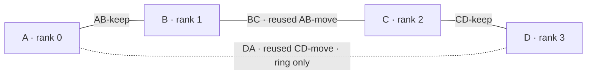

# Prepare four Sparks from two pairs

This page shows how to turn two existing pairs of Sparks into one group of
four for the official Flash-Next FP8 checkpoint. To serve FP4-Local on two
pairs with no new cables, see
[two pairs behind one address](#two-pairs-behind-one-address).

**This build has not yet passed its qualification checks running natively on
four Sparks.** We have measured FP8 on four of our Sparks four times in published cards:

- 2026-10-25 at `6cb46bf`
  ([cards](benchmarks.md#previous-2026-10-25-main-80ac2d4-home-dgx-sparks)):
  drafting ON and OFF gave identical token IDs in 62 of 62 responses.
- 2026-10-28 at `76977df`
  ([cards](benchmarks.md#current-2026-10-28-end-of-day-main-76977df-home-dgx-sparks)):
  drafting ON and OFF matched in 66 of 66.
- 2026-10-30 at `380d8e5`
  ([cards](benchmarks.md#previous-2026-10-30-morning-main-380d8e5-home-dgx-sparks)):
  two server starts with drafting ON. Both matched the 2026-10-28 four-Spark
  card in 66 of 66. One chat wrote prose at 47.321 tok/s and eight chats
  wrote 129.360 tok/s in total (the mean of the two starts).
- 2026-10-31 at `dc32b7c`
  ([results](results.md)): one server start, drafting ON and OFF. ON and OFF
  matched in 66 of 66, and both matched the four-Spark cards of the
  evening before (main `7943f57`) in 66 of 66. One chat wrote prose at 49.508 tok/s and eight chats wrote 130.999
  tok/s in total.

Four Sparks give different token IDs than two: on 2026-10-28, 2026-10-30 and
2026-10-31, 7 of 66 responses were the same
([cause and fix](benchmarks.md#fp8-on-two-and-four-sparks-different-token-ids)).
These cards ran through a lab launcher with context 32768, output 16384 and
drafting depth 2. They measure speed; they are not the four-Spark
qualification. For the qualification, keep the official precision and the
FP8 defaults: a 131,072-token context and an output limit of
`min(65536, context)` (see
[FP8 limits](../cli/README.md#fp8-limits-and-drafting)). No card has measured
that default context yet ([not tested yet](install-fp8.md#not-tested-yet)). If
you choose a smaller context on purpose, that is a separate configuration; it
is not a way to qualify the default.

You will also need:

- [Spark system setup](spark-setup.md) for the OS and network
- [INSTALL.md](../INSTALL.md) for the checkpoint and pinned compilers
- the [Rust gates](../cli/docs/test.md) (the test suites a build must pass)
  for qualification

The setup scripts live in `ops/scripts/spark-setup/`.

Two roles come up throughout: the **operator** runs these machines, and the
**administrator** changes their OS and network. If you run your own Sparks,
both may be you. This guide helps them prepare the change. It does not switch
the network on, and it is not permission to take over machines that are in
use.

## Label the machines and cables before unplugging anything

Pick two pairs that are idle and reserved for this work. Call the first pair
**A and B** and the second **C and D**. These letters are labels for this
guide, not machine names. The rank order (each Spark's position in the group)
will be A=0, B=1, C=2, D=3. Keep the management LAN cables plugged in on all
four machines (that is your ordinary network, the one you SSH over), and make
sure you can still reach each machine from a local console in case you need to
recover.

Each pair already has two physical QSFP cables. Label both ends of all four
cables, and the sockets they sit in. In each pair, pick either cable to keep.
Before you change anything, write down this map somewhere private:

| Cable label | Connects now | What to do |
| --- | --- | --- |
| AB-keep | A to B | Leave both ends plugged in |
| AB-move | A to B, their other QSFP sockets | Unplug both ends |
| CD-keep | C to D | Leave both ends plugged in |
| CD-move | C to D, their other QSFP sockets | Unplug both ends |

Next, run `vade down` and then `vade status` for each pair, using the private
CLI configuration for that pair. Confirm that all four GPUs are empty and that
nobody else owns a network test or server on them. Then save everything you
would need to roll back each pair: its CLI state, the cable map, the interface
addresses, the routes, and the exact fabric profiles or files. Do not look at
or copy private keys or unrelated network credentials. Never move a cable while
a rank still uses it.

## Make the path, then optionally close the ring

1. Leave **AB-keep** and **CD-keep** alone.
2. Unplug both ends of **AB-move** and **CD-move**. A, B, C and D now each have
   exactly one free QSFP socket. The management LAN stays connected.
3. Plug **AB-move** into B's freed socket and C's freed socket. Relabel both
   ends **BC**. You now have a three-cable path: **A-B-C-D**.
4. For a path, keep **CD-move** as a labeled spare and leave the freed sockets
   on A and D empty. For a ring, plug it into D's freed socket and A's freed
   socket, and relabel both ends **DA**. You now have **A-B-C-D-A**.
5. Follow every cable from end to end and write down the socket it actually
   sits in at each end. Do not guess the Ethernet or RDMA device from a
   left/right sticker; use the
   [interface-to-device mapping](spark-setup.md#1-make-a-private-cable-map).



One QSFP cable gives you **two Ethernet rails** (two separate network
interfaces over the same cable), not two independent links to the neighbor.
Configure and check both rails. A four-Spark path has three cables and six rail
subnets; a four-Spark ring has four cables and eight rail subnets. There is no
switch, and nothing routes fabric traffic between machines that are not cabled
to each other.

## Update only the affected fabric configuration

After the move, the old settings for the two cables you moved still describe
A-B and C-D, not B-C or D-A. Write down this new rail plan privately:

| Cable | Subnets for its two rails | Addresses at each end, within each subnet |
| --- | --- | --- |
| AB-keep | Keep its two verified, disjoint subnets | Keep A's and B's |
| BC | Two new unused `/24` subnets | B is host 1; C is host 2 |
| CD-keep | Keep its two verified, disjoint subnets | Keep C's and D's |
| DA, ring only | Two further new unused `/24` subnets | D is host 1; A is host 2 |

Before you assign subnets, check the LAN, VPN and routing tables on all four
machines. Every subnet must be distinct across the whole new group, including
the ones the two kept pairs already use. If any overlap, the administrator must
renumber the conflicting rail, at both of its ends, as part of this plan.

Each rail gets its own:

- subnet
- Ethernet device and matching verbs device (the RDMA device behind it)
- IPv4 RoCE-v2 GID
- peer alias

Every rail uses MTU 9000 and RDMA path MTU 4096. Set no gateway and turn on no
forwarding.

On each machine, create a **new** ignored configuration directory with
`init-config.sh`, as in [step 1](spark-setup.md#1-make-a-private-cable-map).
For a path, use the `pair` template on A and D (two rows each) and the `ring`
template on B and C (four rows each); for a physical ring, use `ring` on all
four. The template names only choose how many local rail rows you get; they do
not choose Vade's transport topology. Fill in the seven fields of each row in
`links.tsv` from the new cable map: Ethernet device, RDMA device, local address
with its `/24`, peer address, peer alias, RoCE-v2 GID index and bandwidth-test TCP
port. The matching row on the peer may have a different row
number, but its endpoints, rail and bandwidth test port must agree.

**The network step of `apply.sh` only sets up unused interfaces. It
deliberately refuses to overwrite a different fabric configuration that
already works.** These pairs are already configured, so the administrator
should save and then edit only the exact profiles or files that own the moved
rails:

- Do not delete existing profiles, rename a file to get past the preflight
  check, or apply a second configuration on top.
- Keep the original files, profile identities and addresses somewhere private
  so you can restore them.
- On the two ends of a path, remove only the old moved-link addresses and
  routes from the sockets that are now unused.
- Leave AB-keep, CD-keep and management networking intact, apart from any
  subnet conflict you have explicitly reviewed.

Use `render.sh` to review the target files and hosts entries you want. If the
administrator has prepared interfaces that are genuinely unused, the normal
sequence from the Spark system setup guide works: preview, apply, and keep the
transaction for rollback. Otherwise the administrator must apply the reviewed
fabric migration through whatever already owns that configuration. Either way,
keep a console-backed rollback ready, and check that management access still
works before you accept the activation, as described in
[step 3 of Spark system setup](spark-setup.md#3-install-and-activate-the-fabric-network).

Read the actual GIDs again after any address change; the placeholder GID index
used before addresses exist proves nothing. Keep the existing working account
permissions, kernel and launch-session limits; changing them needs its own
setup procedure.

Run [rail verification](spark-setup.md#8-verify-every-rail-and-the-actual-launch-session)
as the Vade account, in the same session you will launch from: first the
prerequisite checks on every machine, then the bounded bandwidth server/client
test on **both rails of every cable, in both directions**. That is 12 client
results for a path or 16 for a ring, plus their matching server logs. Positive
bandwidth shows the link connects; it is not a performance target. Stop on any
failure. Then confirm once more: management SSH, unlimited soft and hard
memlock, matching MTUs, device access and trusted peer identities. Keep filled
configurations and raw evidence out of Git.

## Configure Vade in cable order

Add four machine sections to the private CLI configuration. Each
`fabric.<peer>` value is **this machine's own address** on the rail to that
peer, with no port. Pick one verified primary rail and use it consistently at
both ends:

| Machine | Fabric entries it needs for a path |
| --- | --- |
| A | `fabric.B` = A's address on AB-keep |
| B | `fabric.A` = B's address on AB-keep; `fabric.C` = B's address on BC |
| C | `fabric.B` = C's address on BC; `fabric.D` = C's address on CD-keep |
| D | `fabric.C` = D's address on CD-keep |

Put the real section names in place of A, B, C and D only in your private
configuration. The `ssh` fields use management aliases the Mac can reach,
including for ranks that are not cabled to each other. All four ranks need the
same model path and the same staged PTX path, each written out in full
(expanded and absolute), and their artifact hashes must match. The
[CLI setup](../cli/README.md#multi-spark-source-setup) shows how.

`vade up --fp8 --sparks 4` takes the first four configured machines, in
order; without `--fp8`, `vade up` refuses an FP8 config. If the
configuration lists other machines too, prefer an explicit ordered `--hosts`
list. Preview with `--dry-run`, then launch with the same settings while no one
else is using the four Sparks. For the first smoke request, launch with
`--mtp 0`, which turns off MTP (multi-token prediction, the model drafting
tokens ahead).

For four Sparks the launcher picks the **logical path** topology, even when
the physical cables form a ring; Vade then leaves DA unused. Adding DA fabric
entries does not turn `vade up` into a ring launcher, so do not label that run
as a ring measurement. A native ring gate
(a qualification run) must explicitly select `TP_TOPOLOGY=ring`, use all four
neighbor addresses, and get its own golden set (saved reference answers).

For four ranks, the native `vade test determinism` command takes each rank's
own **LISTEN** and **NEXT** addresses, between the fixtures and the rank number:
`-- MODEL FIXTURES LISTEN NEXT RANK --world 4` (see the
[world-four procedure](../cli/docs/test.md#world-four-goldens)). Fill in this
symbolic table privately.
`B-on-AB` means B's own primary address on the retained AB cable, and `PORT`
is one free port for the native gate run, the same on every rank:

| Rank | Path LISTEN | Path NEXT |
| --- | --- | --- |
| A / 0 | `A-on-AB:PORT` (ignored) | `B-on-AB:PORT` |
| B / 1 | `B-on-AB:PORT` | `C-on-BC:PORT` |
| C / 2 | `C-on-BC:PORT` | `D-on-CD:PORT` |
| D / 3 | `D-on-CD:PORT` | `A-on-AB:PORT` (ignored) |

For a native ring, replace A's LISTEN and D's NEXT with `A-on-DA:PORT`; every
other entry stays the same. Give real numeric socket addresses even for the
two ignored path arguments.

Do not confuse NEXT with a local `fabric.<peer>` entry: NEXT names the **next
peer's** incoming interface. These addresses go straight to `flash-bench` as
data endpoints, with no extra port offset added. The product server works
differently: it has a separate control port, uses the control port plus one for
data, and `vade up` manages that for you.

The current path transport discovers the second rail on each neighbor link,
and large transfers can use both rails when discovery succeeds. The existing
closed-ring transport uses one primary rail per neighbor. Check both rails at
the OS level either way, and record which ones the transport actually uses.

## Qualify, then restore or hand over

Follow the [world-four golden procedure](../cli/docs/test.md#world-four-goldens) ("world four"
means four ranks; goldens are saved reference answers). First, on the same pair,
confirm that the world-two (two-rank) bytes still match the base. Then capture
world-four goldens twice, and compare only runs with matching world, topology
and rank-order settings. Different Spark counts may produce different bytes,
but each setup must repeat exactly and pass the quality checks. Neither a check
on the Mac nor a successful startup shows this.

When the four-rank work is done, run `vade down` with the four-rank
configuration and check that all four GPUs are empty. Then restore the pairs:

1. Unplug both ends of BC and of DA (if present).
2. Put AB-move back in A's and B's recorded sockets, and CD-move back in C's
   and D's.
3. With the administrator's rollback procedure, restore the exact saved
   moved-rail profiles, addresses and aliases, and any kept rail that was
   renumbered. Recabling alone does not bring back the old network.
4. Check both rails of **both cables in each pair** before relaunching the
   original two-rank configurations.

Once the operator has accepted either the verified four-Spark setup or the
restored pairs, the machines are free for other work.

## Two pairs behind one address

This mode is an option. It does not change the default four-Spark mode:
`vade up --sparks 4` starts the FP4-Local four-way tensor split over RDMA (the
layer chain over TCP). The project owner decides whether this mode becomes the
default.

`vade up --replicas 2 --pairs` starts two FP4-Local servers. Each server is a
two-Spark tensor split, the same path as `vade up --sparks 2`. The pairs keep
their own cables. No cable between the pairs is necessary. Give the four
machines as two pairs in order: the first and second machine form pair 1, and
the third and fourth form pair 2. Each pair needs its `fabric.<peer>` entries
at both ends, as for one pair:

```sh
vade up --replicas 2 --pairs --hosts a,b,c,d --dry-run
vade up --replicas 2 --pairs --hosts a,b,c,d
```

`vade up` opens one tunnel to the first machine of each pair, on
`local_port + 1` and `local_port + 2`. It starts `vade-gateway` on
`local_port`, so clients use one address. The gateway runs with
`--stable-prefix`, which adds `prompt_cache_key` and `cache: true` to a
request that does not set them. Then each pair's prefix cache can serve the
later turns of a chat. The engine treats a `prompt_cache_key` as a request for
the cache, so `"cache": false` alone does not turn the cache off through this
gateway. Token IDs stay the same; memory use and first-turn time can change.

The gateway routes each request to one pair:

- A first turn (nothing after its first user message) goes to the pair with
  fewer requests in flight through the gateway. On a tie, it goes to the pair
  that served the same key before, if there is one; otherwise ties take turns.
  Identical prompts sent at the same time divide evenly between the pairs.
- A later turn of the same chat (anything after the first user message:
  another user turn, a reply or a tool result) goes to the pair that served the
  previous turn while that pair has fewer than 8 requests in flight or is
  among the least busy. The gateway identifies
  a chat by its `prompt_cache_key`, else by a session header, else by the
  model, instructions, system prompt, tools and messages through the first
  user message.
- One chat runs on one pair (two Sparks), never on all four.

If a pair stops before it sends a reply byte, the gateway sends the request to
the other pair. If a pair stops during a reply, the client gets a cut reply.
The gateway does not resend it, and it does not join output from the two
pairs. The next turn goes to the live pair, which reads the full chat again
with no cache. `GET /health` returns HTTP 503 with `"status":"degraded"` while
one pair is down.

Both pairs run the same engine build and checkpoint. The gateway health check
returns an error if they differ. Token IDs must be identical on each pair, as
for any two-Spark tensor split. No measurement card exists yet for this mode
through one address, so this page makes no speed claim. The
[benchmarks](benchmarks.md) give the cards for one pair and for the four-Spark
layer chain.
