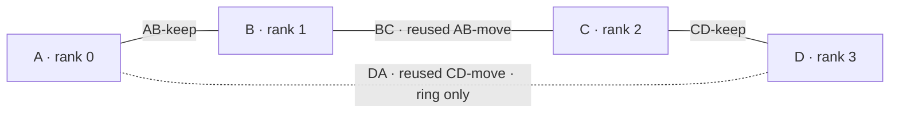

# Prepare four Sparks from two pairs

This is the preparation route for the official Flash-Next FP8 checkpoint on
four Sparks. **Native four-Spark qualification of this build is pending.**
The existing two-Spark measurements do not establish four-Spark correctness,
memory capacity or speed. Keep the official precision, 131,072-token context
default and 8,192-token output cap. A smaller explicit context is a separate
configuration, not a way to qualify the default.

Use [Spark system setup](spark-setup.md) for OS and network preparation,
[INSTALL.md](../INSTALL.md) for the checkpoint and pinned compilers, and the
[Rust gates](../cli/docs/test.md) for qualification. The setup scripts live in
`ops/scripts/spark-setup/`. This guide prepares a change for the operator; it
does not activate a network or authorize taking over machines in use.

## Label the machines and cables before unplugging anything

Choose two idle, reserved pairs. Call the first pair **A and B** and the second
**C and D**. These are labels in this guide, not machine names. Rank order will
be A=0, B=1, C=2, D=3. Keep management LAN connections plugged in on all four
machines, and retain a local-console recovery path.

Each existing pair has two physical QSFP cables. Label both ends of all four
cables and their sockets. Choose either cable in each pair to keep, then record
the following map privately before changing it:

| Cable label | Current endpoints | Action |
| --- | --- | --- |
| AB-keep | A to B | Leave both ends plugged in |
| AB-move | A to B, their other QSFP sockets | Unplug both ends |
| CD-keep | C to D | Leave both ends plugged in |
| CD-move | C to D, their other QSFP sockets | Unplug both ends |

Use `vade down` with each pair's owning private configuration, then `vade status`.
Confirm all four GPUs are empty and that no other user owns a network test or
server. Preserve each pair's private CLI state, cable map, interface addresses,
routes and the exact fabric profiles/files needed for rollback. Do not inspect
or copy private keys or unrelated network credentials. Do not move a cable
while a rank still uses it.

## Make the path, then optionally close the ring

1. Leave **AB-keep** and **CD-keep** untouched.
2. Unplug both ends of **AB-move** and **CD-move**. A, B, C and D now each have
   exactly one free QSFP socket. The management LAN remains connected.
3. Plug **AB-move** into B's freed socket and C's freed socket. Relabel both
   ends **BC**. You now have the three-cable path **A — B — C — D**.
4. For a path, store **CD-move** as a labeled spare and leave A's and D's freed
   sockets empty. For a ring, plug it into D's freed socket and A's freed
   socket, and relabel both ends **DA**. You now have **A — B — C — D — A**.
5. Trace every cable end to end and record its actual socket at each end. Do
   not infer the Ethernet/RDMA device from a left/right sticker: use the
   [interface-to-device mapping](spark-setup.md#1-make-a-private-cable-map).

One QSFP cable exposes **two Ethernet rails**, not two independent neighbor
cables. Configure and check both rails. A four-node path has three cables and
six rail subnets; a four-node ring has four cables and eight rail subnets.
There is no switch and no fabric routing between nonadjacent machines.

## Update only the affected fabric configuration

The old second links still describe A–B and C–D after the cables move. They
cannot be assumed to describe B–C or D–A. Record this new private rail plan:

| Cable | Rail subnets | Endpoint addresses within each subnet |
| --- | --- | --- |
| AB-keep | Preserve its two verified, disjoint subnets | Preserve A and B |
| BC | Two new unused `/24` subnets | B is host 1; C is host 2 |
| CD-keep | Preserve its two verified, disjoint subnets | Preserve C and D |
| DA, ring only | Two further new unused `/24` subnets | D is host 1; A is host 2 |

Check all four machines' LAN, VPN and routing tables before assigning subnets.
Even the two retained pairs' subnets must be distinct across the whole new
group. If they overlap, the administrator must renumber the conflicting rail
and its two endpoints as part of this plan. Each rail has its own subnet,
MTU 9000, Ethernet device, matching verbs device, IPv4 RoCE-v2 GID and peer
alias. Use RDMA path MTU 4096. Set no gateway and enable no forwarding.

Create a **new** ignored configuration directory on each node with
`init-config.sh`, following [step 1](spark-setup.md#1-make-a-private-cable-map).
For a path use its `pair` template on A/D (two rows each), and its `ring`
template on B/C (four rows each). For a physical ring use `ring` on all four.
These template names select the number of local rail rows; they do not select
Vade's transport topology. Populate the seven fields in `links.tsv` from the
new cable map. The corresponding peer row may have a different row number;
its endpoints, rail and bandwidth test port must agree.

**The setup network apply step is for unused interfaces. It deliberately
refuses to overwrite a different working fabric configuration.** For these
already configured pairs, have the administrator preserve and edit only the
exact profiles or files that own the moved rails. Do not delete existing
profiles, rename a file to evade the preflight, or apply a second configuration
on top. Retain the original files/profile identities and addresses privately
so they can be restored. On path endpoints, retire only the old moved-link
addresses/routes from the now-unused sockets. Keep AB-keep, CD-keep and
management networking intact, except for any explicitly reviewed subnet conflict.

Use the setup renderer to review the desired target and hosts entries. If the
administrator has prepared genuinely unused interfaces, the guide's normal
preview/apply/transaction sequence can be used. Otherwise the administrator
must apply the reviewed fabric migration through its existing configuration
owner. Use console-backed rollback and verify live management access before
accepting activation, as described in
[network setup](spark-setup.md#3-install-and-activate-the-fabric-network).
Re-read actual GIDs after address changes; a staging GID index is not evidence.
Preserve existing working account permissions, kernel and launch-session
limits; changes to them require their separate setup procedure.

Run [rail verification](spark-setup.md#8-verify-every-rail-and-the-actual-launch-session)
as the Vade account in the actual launch session. Run prerequisite checks on
every node, then the bounded bandwidth server/client test on **both rails of
every cable, in both directions**. That is 12 client results for a path or 16
for a ring, plus their matching server logs. Positive bandwidth is connectivity
evidence, not a performance target. Stop on any failure. Reconfirm management
SSH, unlimited soft/hard memlock, matching MTUs, device access and trusted peer
identities. Keep filled configurations and raw evidence outside Git.

## Configure Vade in cable order

Add four machine sections to the private CLI configuration. Each
`fabric.<peer>` value is **this machine's own address** on the rail to that peer,
without a port. Use one verified primary rail consistently at both endpoints:

| Machine | Required fabric entries for the path |
| --- | --- |
| A | `fabric.B` = A's address on AB-keep |
| B | `fabric.A` = B's address on AB-keep; `fabric.C` = B's address on BC |
| C | `fabric.B` = C's address on BC; `fabric.D` = C's address on CD-keep |
| D | `fabric.C` = D's address on CD-keep |

Replace A/B/C/D with the real section names only in private configuration.
The `ssh` fields use management aliases reachable from the Mac, including the
nonadjacent ranks. All four ranks need the same expanded absolute model and
staged PTX paths and matching artifact hashes; follow the
[CLI setup](../cli/README.md#multi-spark-source-setup).

`vade up --sparks 4` takes the first four configured machines in order.
Prefer an explicit ordered `--hosts` list when the configuration contains
other machines. Preview with `--dry-run`, then launch with the same settings
during the reserved hardware window. Use MTP 0 for the first smoke request.
The launcher selects **logical path** topology for four Sparks, including when
the physical cables form a ring: DA is then unused by Vade. Adding the DA
fabric entries does not turn `vade up` into a ring launcher. Do not label that
run as a ring measurement. A native ring gate must explicitly select
`TP_TOPOLOGY=ring`, use all four neighbor addresses, and get its own golden set.

For the native `vade test determinism` invocation, the two address arguments
are **LISTEN and NEXT on each rank**. Fill this symbolic table privately;
`B-on-AB` means B's own primary address on the retained AB cable, and `PORT`
is the same available native gate port everywhere:

| Rank | Path LISTEN | Path NEXT |
| --- | --- | --- |
| A / 0 | `A-on-AB:PORT` (ignored) | `B-on-AB:PORT` |
| B / 1 | `B-on-AB:PORT` | `C-on-BC:PORT` |
| C / 2 | `C-on-BC:PORT` | `D-on-CD:PORT` |
| D / 3 | `D-on-CD:PORT` | `A-on-AB:PORT` (ignored) |

For a native ring, replace A's LISTEN and D's NEXT with `A-on-DA:PORT`.
All other entries stay the same. Supply real numeric socket addresses even
for the two ignored path arguments. These are direct `flash-bench` data
endpoints; no additional port offset is applied. The product server has a
separate control port and uses control-port-plus-one for data, managed by
`vade up`. Do not confuse a local `fabric.<peer>` entry with NEXT, which names
the **next peer's** incoming interface.

The current path transport discovers the second rail on each neighbor link;
large transfers can use both rails when discovery succeeds. The existing
closed-ring transport uses one primary rail per neighbor. Verify both rails
at the OS level regardless, and record actual transport use. The parked
closed-ring RDMA optimization is not part of this preparation change.

## Qualify, then restore or hand over

Use the [world-four golden procedure](../cli/docs/test.md) and the assigned
external four-Spark qualification plan. First preserve world-two bytes against
the base on the same pair; then capture world-four goldens twice and compare
only matching world/topology/rank-order settings. Different Spark counts may
produce different bytes, but each setup must remain exactly repeatable and
pass quality checks. A Mac check or a successful startup does not establish this.

After the four-rank work, use `vade down` with the four-rank configuration and
verify all four GPUs are empty. To restore the pairs, unplug both ends of BC
and DA (if present). Return AB-move to A/B's recorded sockets and CD-move to
C/D's recorded sockets. Restore the exact saved moved-rail profiles, addresses
and aliases using the administrator's rollback procedure; restore any retained
rail that was renumbered too. Verify both rails of **both cables in each pair**
before relaunching the original two-rank configurations. Physical recabling
alone does not restore the old network. Release reservations only after the
operator has accepted either the verified four-node handover or the restored pairs.
