<p align="center"></p>

# Vade Harness

Vade Harness is the terminal program you use to work with the model. It is both
a coding agent and a chat client, written in first-party Rust with no
third-party crates. The model itself runs in the [engine
workspace](../engine/README.md) in this monorepo. The engine does the inference
and keeps the KV state, the attention memory it holds for each conversation
(see [KV cache](../docs/GLOSSARY.md#ho) in the glossary).

It gives you:

- a native **tool-aware agent**. It reads and lists files, makes exact patch
  edits and, on macOS, runs sandboxed commands once you approve them, all
  inside a workspace you pick and within fixed limits;
- direct streaming **text chat**. Its only tools are local commands you type,
  such as `/ls` and `/read`;
- an offline **demo**;
- [project memory](docs/memory.md) for facts, preferences, decisions, and corrections across chats;
- a **gateway** command that sits between another client and the engine;
- a hand-off of each turn to **Codex** (through its app-server) or to a
  **Hermes** agent (over ACP v1), if you have one installed.

We keep the native harness small on purpose. Changes to it add automatic
limits, make its requests [greedy](../docs/GLOSSARY.md#dg) and cache-friendly,
or fix bugs.

Already have a coding client you like? You can keep it and put Vade's gateway in
front of the engine instead; way 2 below shows how.

This page starts with a first run and the four ways to use Vade, then walks
through the native agent, the terminal and client setup. The finer details
(gateway routing, how requests are built, the agent's deeper limits) come after
[Going deeper](#going-deeper). What has and has not been checked is under
[What has been validated](#what-has-been-validated).

## Build and run from source

Start with the offline demo: it needs no engine, no Spark and no network. From
`harness/` in this monorepo, use the pinned Rust `1.99.0` compiler:

```sh
cargo +1.99.0 build --offline
cargo +1.99.0 run --offline -- demo
cargo +1.99.0 run --offline -- --demo --prompt "Show me the local demo"
cargo +1.99.0 run --offline -- --help
export PATH="$PWD/target/debug:$PATH"
```

With no mode argument you get the **demo**. It gives a clearly labeled scripted
response and makes no network requests.

Talking to a model needs a running engine (next section). Direct mode needs both
an endpoint and a model, and native agent mode also needs an explicit workspace.
The commands below expect an OpenAI-compatible server that is already listening
on `127.0.0.1:18080` and serves a model named `mock`. This page does not set
one up, so bring your own, or start the engine first and put its model ID in
place of `mock`. Choose one: `direct` and `agent` open a client for that server;
`gateway` starts a listener on `127.0.0.1:8787` that forwards incoming requests
to it. Stop the client or gateway with Ctrl+C before choosing another:

```sh
vade-harness direct --endpoint http://127.0.0.1:18080/v1/chat/completions --model mock
vade-harness agent --endpoint http://127.0.0.1:18080/v1/chat/completions --model mock --workspace .
vade-harness gateway --upstream http://127.0.0.1:18080 --bind 127.0.0.1:8787
```

## Four ways to run Vade

Start the engine first with [INSTALL.md](../INSTALL.md):
[Route A](../INSTALL.md#route-a-on-this-spark) if you work on the Spark itself,
or [Route B](../INSTALL.md#route-b-from-a-controller) if you drive it from
another Linux or macOS computer (a controller). The engine listens on
`http://127.0.0.1:18080`, and the FP4-Local server that INSTALL.md installs
serves the model `qwen3.8-flash-next-fp4-local`. Wherever a command below says
`MODEL`, put that ID (or your own server's exact model ID).

- The engine keeps running until you type `vade down`. On a controller, the
  network tunnel to the Spark stays open until then too. Any client, direct or
  through a gateway, can connect while the engine is up.
- The [FP8 connection
  guide](../engine/docs/flash-server.md#run-the-native-coding-agent) uses its
  own model ID and profile.

Pick the way that fits how you work:

1. **Use ours (Vade Engine + Vade Harness).** You run the Vade harness against
   the Vade engine, with our native UI and its bounded workspace tools.

   `vade-harness agent --endpoint http://127.0.0.1:18080 --model MODEL --workspace .`

   > **Heads-up:** the agent's shell tool runs only on macOS today, inside the
   > macOS sandbox. On the Spark itself (Linux), the agent can read, search and
   > patch files but cannot run commands, so build checks such as `cargo test`
   > do not run either ([what that looks like](../INSTALL.md#chat-and-the-coding-agent-on-linux)).
   > For the full agent, drive the Spark from a Mac controller (Route B).

2. **Put ours in front (your harness through Vade's gateway).** You keep your
   own harness and point its provider at port 8787, where Vade's gateway sits
   between it and the engine. Only the client's base URL changes. Start the
   [`vade-gateway` binary](docs/invisible-gateway.md) as in INSTALL:

   `vade-gateway --upstream http://127.0.0.1:18080/v1`

   It forwards Chat Completions, Responses and every other HTTP path, including
   `GET /v1/models`. It can also add stats, recording and replay, plus a few
   optimizations that stay off until you turn them on with flags. The [client
   setup guide and what we tested](docs/passthrough-matrix.md) covers each
   client.

   The harness also has a built-in gateway,
   `vade-harness gateway --upstream http://127.0.0.1:18080`. It serves only the
   API routes listed under [Gateway relay, Codex and Hermes in
   detail](#gateway-relay-codex-and-hermes-in-detail), including the model
   list that Open WebUI, Continue and the OpenAI SDKs read first. It answers
   501 to `/v1/embeddings` and 404 to any other path. The [OpenAI-compatible
   API](../docs/openai-api.md) page lists what each route accepts.

3. **Hand turns to Codex or Hermes (Vade UI + installed agent).** You keep the
   Vade UI, and the installed agent owns each turn.

   `vade-harness codex --workspace . --permission read-only`

   For Hermes, use `hermes` mode with `--permission deny-callbacks`. That
   permission setting is not an OS sandbox.

4. **Bring your own (Vade Engine alone with any compatible client).** You point
   any compatible client straight at the engine. No harness process is needed.

   `curl -q http://127.0.0.1:18080/v1/chat/completions -H 'Content-Type: application/json' -d '{"model":"MODEL","messages":[{"role":"user","content":"Hello"}]}'`

   FP4-Local thinks by default (`default_thinking: true` in
   `/v1/capabilities`). A plain client therefore gets `reasoning_content`
   first, then `content`. To get just the answer, add
   `"enable_thinking": false` to the request. The Vade harness sends that for
   you unless thinking is on.

## Native coding agent

`agent` (or `--mode agent`) runs the native agent loop with fixed limits. It
needs `--endpoint`, `--model` and an **explicit `--workspace`**. The model gets
these tools: `workspace_read`, `workspace_list`, `apply_patch`,
`workspace_shell`, `tool_output_read`, `skill_read`, `workspace_manifest`,
`workspace_symbols`, `workspace_search` and `workspace_read_lines`.
The [web tools](docs/agent-tools.md#web-reads-and-search) read URLs and search the web; `--no-web` or `VADE_WEB=0` turns both off.

The agent's tools always run on the computer where you start the harness, in
the workspace you pick there. When you drive the Spark from a controller
(another computer; see INSTALL's [Route
B](../INSTALL.md#route-b-from-a-controller)), inference runs on the Spark and
the tools run on the controller.

Commands run only on macOS. On Linux, including the Spark itself, the agent is
not offered `workspace_shell`, and its instructions say it cannot run
commands; `--check` and `--child-shell` are refused there. A resumed session
saved by an earlier version still lists the tool, but a call returns
`unsupported_platform` without running anything. `VADE_HARNESS_SHELL=off`
hides the tool on macOS too, which is how the tests cover the Linux shape on a
Mac.

The FP8 setup on 2, 4 or 6 Sparks has its own
[connection and run recipe](../engine/docs/flash-server.md#run-the-native-coding-agent).

### Search and read

The approach that works best has three steps:

1. Search likely files with `workspace_search` (`path`, `literal` or related
   `literals`). It returns relative paths and line numbers in a complete inline
   JSON result.
2. Read only the lines that matter with `workspace_read_lines`: give a `path`
   and either one `start_line`–`end_line` range or up to eight ordered,
   non-overlapping `ranges` from the same file snapshot.
3. After an edit, run the relevant existing check and repair from what it
   reports.

Search is literal and case-sensitive, capped at 512 files/8 MiB per call. It
skips hidden, credential, link, and dependency/build paths. Each page reads the
live files, which can change between pages. Copy `next_offset` for more
matches, or narrow the path when the scan reports omitted input.

A line read returns up to 200 lines (an inclusive range) from a file of up to
4 MiB, labeled with its path and range, and at most 4 KiB of text. Because
each excerpt is capped at 4 KiB, searching first and reading targeted ranges
works better than paging through a file from the top.

Native `workspace_read` accepts a zero-based byte `offset` and a byte `limit`
(1–4096) for sources up to 4 MiB. Partial results give the actual range, the
total size and the next offset. Reads keep the hidden/credential path and
directory-handle protections.

A PDF file (up to 50 MiB) reads as the text of its text layer, page by page,
and `offset` and `limit` then index that text. The reader is part of the
harness and uses only the Rust standard library. It does not decrypt files or
run OCR, so scanned pages and encrypted files give a short note instead of
text. See [the PDF reader](src/pdf.rs) for what it reads and what it skips.

`workspace_shell` accepts a named offline `check_profile` (`engine-host`,
`engine-bench-host`, `harness-host`, `cli-host`) instead of argv, with a
`--shell-toolchain` you picked. Profiles keep command approval and the
120-second limit. A timeout or cancellation gives a partial result. Passing
host checks says nothing about GPU behavior.

### Patches

`apply_patch` adds, updates, deletes and moves bounded UTF-8 files. It needs
exact, unique old text and existing parent directories; there is no fuzzy
matching. Patch text is limited to 64 KiB, and each target and result may be up
to 4 MiB.

**The preview.** `apply_patch` checks all files first and shows unified diff
hunks with three context lines before you approve. Overlapping context is
merged. Nonprinting Unicode, tabs, carriage returns and literal backslashes are
visibly escaped. The 192 KiB cap counts the escaped display bytes, and an
oversized diff is refused before approval.

**How files are written.** Updates stage a temporary file in the same
directory, sync it, recheck the original metadata and bytes, then rename it into
place atomically. Adds and moves never replace an existing destination. Delete
sections must contain the entire exact old text. Existing permission bits are
kept.

Atomicity is **per file**, not a batch transaction. A combined move and edit can
therefore leave both paths if it is interrupted between installing the new file
and removing the source. Partial results and conflicts are reported explicitly.
See [tool grammar and limits](docs/agent-tools.md).

### Shell commands and the sandbox

On macOS every command runs in the OS sandbox (`sandbox-exec`). Inside it, a
command:

- runs with a cleared environment, the workspace as its working directory and
  no network;
- can read system and toolchain files;
- can write only to the workspace and a private build folder.

`workspace_shell` takes an explicit `argv` and `timeout_ms`; to run a script,
ask for `/bin/sh -c` explicitly. Hidden paths, common credential files,
`target/` and `node_modules/` stay out of reach, and hard links cannot be
created. Add up to eight more folder names with `--shell-exclude NAME`.

Builds and caches (Cargo, npm, HOME, XDG, temp files) go to a fresh private
folder outside the workspace. It lasts for the session and is thrown away on
exit, `/new`, resume, switch or fork. It is capped at 1 GiB / 100,000 entries,
checked between commands. Cargo and npm run offline. System and Homebrew tools
stay available.

If your Rust toolchain lives under your home folder, launch with
`--shell-toolchain DIR` pointing at the real distribution (with `bin/cargo`,
`bin/rustc`, `bin/rustdoc` and `lib`); rustup shims are not used. Package
installs are not possible, there is no unsandboxed fallback, and other
platforms refuse to run commands. Full rules: [agent
tools](docs/agent-tools.md#the-macos-sandbox).

### Approvals and command limits

There are three approval policies:

| Policy | What runs without asking |
| --- | --- |
| `--approval ask` (default) | Only commands that an allow-list rule matches (empty by default; see [shell safety](../docs/shell-safety.md)). Edits and every other command wait for you. |
| `--approval auto` | Validated exact patches and all validated commands, inside the existing macOS sandbox, after preview. `--yes` and `--dangerously-skip-prompts` select this policy. That includes programs inside the workspace, such as `./scripts/build.sh`, and explicit `/bin/sh -c` commands. |
| `--approval never` | Nothing: it denies both writes and commands. |

MCP tool calls follow the same policy: `ask` asks before each call, `auto`
runs it after preview, and `never` denies it. See [MCP tools in
chat](../docs/mcp.md).

In every policy, blocked commands (fork bombs, `rm -rf /` and similar) never
run. [Shell safety](../docs/shell-safety.md) describes the three command
classes, the `s`/`p` answers and the allow lists in `.vade/permissions.json`
and `~/.vade/permissions.json`.

**Answering a prompt.** Under `ask`, type `y` or `n` on an empty line (or
`/approve` / `/deny`) in the terminal. The patch preview shows additions and
removals in color.

- A `y`/`n` typed while there is a draft in the editor, during `/paste`, or
  within 400 ms of the prompt appearing is kept as text.
- `/approve` and `/deny` answer the displayed operation once, exactly like y/n,
  and sending them never authorizes a later operation.
- With a draft already in the input, type `/approve` or `/deny` on its own final
  line and press Enter; the earlier draft stays. Pasted or recalled multiline
  text cannot trigger this final-line shortcut.

**What auto still denies.** Under `auto`, writes stay limited to the workspace
and the private session build/cache/temp area. Network, hidden paths,
credentials and excluded trees stay denied. Auto never allows execution outside
that sandbox. There is no unsandboxed route: broader access is refused, and
unsupported platforms fail closed.

The UI shows the active policy, the command, the deadline and the patch diff.
Noninteractive or one-shot requests that need approval are denied. Approvals
expire after 120 seconds and never carry over into a resumed session.

**Command limits.** Each command gets:

- a 120-second maximum deadline;
- at most 64 KiB of displayed output (the native adapter reserves room for
  result framing and UTF-8 overhead);
- null stdin and bounded pipes;
- kernel limits on CPU, file size, processes and descriptors.

When output is too long, the harness keeps a bounded start and end and drops
the middle. It still drains both pipes, so long output does not stall the
command, and you still get its exact exit status. It reports how many bytes it
saw and dropped, and the elapsed time; the dropped middle cannot be recovered.
Cancellation, timeout and a normal child exit all kill the owned process group
and reap the child.

These sandbox and process limits protect against accidents, not against a
deliberately hostile program. The [process limits](docs/agent-tools.md#process-limits)
in the tool reference spell out where that line sits.

### Sessions and journals

**Where sessions live.** Native sessions are journaled by default, one per
workspace path, in the private `VADE_HOME/projects/NAME-HASH/sessions`
directory (`~/.vade` without `VADE_HOME`). They are never kept inside the
workspace. Input recall sits next to them in `history`. `--vade-home DIR` picks
another root.

`--state-in-project` keeps the legacy `WORKSPACE/.vade` folder, which then gets
a `.gitignore` of `*` (except `check`) so git ignores it. Every state folder
gets that `.gitignore`. Journals that older versions wrote to `WORKSPACE/.vade`
stay there; resume them with `--state-in-project`.

**Naming, resuming and switching.** `--session ID` creates a session with that
ID; otherwise an ID is generated. `--name NAME` gives the session a display
name. `--resume ID|NAME|last` explicitly restores a past session (`last` is the
newest one with a turn that no chat has open), and the model and tool
definitions must match. A session belongs to
its workspace folder: a copy or a fresh clone is a different folder, and resume
refuses it. If you move or re-clone the workspace, start a new session there.

- `/sessions` lists sessions, newest first.
- `/resume ID|NAME|last` or `/switch ID|NAME|last` switches after cleanup.
- `/new` creates a fresh journal without deleting old sessions.
- `/undo` is still unavailable for tool histories.

Resume never sends a prompt or replays a tool on its own. Policy and endpoint
come from the new launch, never from stored approvals.

**After a crash.** Before a tool runs, a synced record marks its outcome as
unknown. Completed results are synced before the agent continues. After a crash,
an explicit resume throws away only an incomplete final record and restores the
last closed call/result history. An `unknown_outcome` means you must inspect the
workspace before repeating any side effect. Complete but corrupt records are
refused.

A journal failure stops execution, and no further prompt runs against a failed
journal. Journals are capped at 64 MiB/8,192 records; start a new session when
one is full. The journal keeps old records even after you deliberately compact
the context.

`vade-harness sessions` lists, exports (as Markdown) or deletes saved sessions
without an engine. [Saved chat sessions](../docs/sessions.md) describes it and
`vade sessions`, the CLI command that runs it.

Forks, branches and the journal format are covered further down, under
[Forks, branches and the journal](#forks-branches-and-the-journal).

### Request limits and cancellation

Each explicit user prompt has these limits:

| Limit | Per prompt |
| --- | --- |
| Tool rounds (one model reply that asks for tools; its calls share the round) | 60 |
| Model turns | 61 |
| Proposed tool calls | 240 |
| Tool results | 64 KiB each, 256 KiB in total |
| Active work time | 20 minutes (time waiting for your approval does not count) |

When the time runs out, the agent cleans up the current tool, keeps the
conversation and journal, and says "Stopped after 20 minutes; say continue to
keep going". Say `continue` to pick the conversation back up with a fresh
request budget.

`--agent-time-limit-seconds N` changes the time limit, and `0` turns it off. To
save the same setting, load a JSON file explicitly with `--config PATH`,
containing `{"agent_time_limit_seconds":1200}`. A missing key uses the 20-minute
default, and the CLI time-limit flag wins over the file. Both options need
native `agent` mode.

These limits apply with or without `--children`, and child tasks keep their own
quotas. The wire/history byte and JSON complexity bounds still apply (4 MiB
request/history). Assistant text and tool previews each have a 1 MiB display
bound per run.

**On cancellation or failure,** completed tool results stay as closed history,
and there is no automatic retry. New requests, session changes and compaction
wait for worker cleanup. Only a validated final `stop` answer counts as a
successful turn. Exit cancels and joins the worker.

Cancelling stops local work; the engine may still finish its current step.
[Cancelling with Esc](docs/performance.md#cancelling-with-esc) describes what
is and is not interrupted.

## Terminal interface

Use `--prompt TEXT` to get one answer and exit.

**Steering.** In a normal session, typing a new message while the model is
still answering **steers** it. Vade cancels the current reply, keeps what was
written so far (marked as partial), and sends your new message. If you would
rather wait your turn, `/queue on` lines up follow-ups instead. Piped input can
still send control commands while a reply is running.

Steering works directly against the engine and through either gateway. A
gateway with one upstream forwards the cancel; one with several upstreams sends
it to every upstream and answers with the first that confirms it.

At end of input (EOF), Vade finishes the current work and any queued prompts
that can run, then lists any held prompts as unsent. `--plain`, redirected
input or output, or `TERM=dumb` switch to simple line input; `NO_COLOR` turns
off color only.

**How a conversation looks.** A native TTY launch creates a fresh interactive
journal; only `--resume NAME` loads an earlier conversation. The input wraps as
you type and when you resize. There are two voices and no boxes: your turns
sit behind a bar, the model's answer has none, and one dim status strip sits
above the `›` prompt.

```text
▌ Fix the failing parser test.

▸ thinking <start>–<end> · <tokens> · <elapsed> · Ctrl+T expand

● Read src/parser.rs
  ⎿ <lines> · <elapsed>

The test failed because ...
╰ <time> · <elapsed> · <tokens> tokens out · <decode rate> · prefill <rate> · first token <elapsed> · <model calls> · ctx <used>/<window> · cached <tokens>/<prompt>

▲ Warning
The next reply would not fit in the model's context.
Vade stopped and kept the history.
Use /compact to shrink older turns, or /new to start over.

<model> · ctx <used>/<window> · in <tokens> · out <tokens> · <rate> · <folder> · approval: ask · <session> · 1 Spark, drafting on
›
```

- **▌** marks every row you wrote, in bold cyan; it reads the same without
  colour.
- **Thinking** is one dim italic row with its start and end clocks. Ctrl+T
  expands it; its text then sits behind a dim `┆` bar.
- **The answer** renders basic Markdown (headings, lists, code, rules, quotes,
  links) and wraps between words. It ends with one dim footer: finish time,
  elapsed time, tokens out, decode and prefill speed, time to first token,
  model calls (requests sent to the model), context use and cached prompt
  tokens, all raw counts. Missing measurements show `—`. Narrow terminals drop
  the last facts first and keep elapsed time, tokens and decode speed.
- **The status strip** shows context used of the window, tokens in and out and
  the last decode speed; `VADE_CHAT_SETUP` (set by `vade chat`) adds the Spark
  count and drafting. While the model works it shows the state, elapsed time
  and live tokens per second.
- **▲ Warning** (yellow) always says what happened, what Vade is doing about it,
  and what you can do.

A run that does not finish normally ends with one plain line such as
`Canceled · <elapsed> · <edits> · check passing · say continue`. The labels
carry the meaning with `NO_COLOR` and in plain or redirected output. The UI uses
the terminal's own foreground and background, so it works in light and dark
themes. `/status` shows the full counters; `--verbose` also prints the contract
details after each run.

The terminal owns mouse selection and Cmd+C, and Vade does not turn on mouse
reporting. PgUp/PgDn scroll the conversation and full approval previews.

**The status row.** The footer row above the input always shows facts. At rest
it shows `model · folder · approval · ctx used/limit · session`. While waiting,
the spinner, the state (`connecting`, `thinking`, `reasoning`, `running tool`)
and the clock sit where the answer will appear. While writing, the row shows the
clock, estimated tok/s, queued follow-ups and the cancel hint. Narrow rows drop
middle facts first. The input box shows its newline keys until you send the
first message.

**Tool rows.** Tool calls print inside the answer flow as `● Run: cargo test`
rows. Each is followed by one indented, dim
`⎿ exit <code> · <lines> · <elapsed>` summary (exit code, line counts, first
error line, applied operations or the written file). Full command and patch
output needs `--verbose`, which describes the command sandbox once, and again
only when it changes.

**The command menu.** `/` opens a menu of the common commands, and typing
searches every command for the mode. ↑/↓ select, and Enter runs the selection
(an ambiguous prefix is completed into the editor first, as Tab does). Esc
closes the menu.

### Attach files

To attach a workspace text file, type `@path` (quote or backslash-escape
spaces). You can also drop or paste an absolute file path as the whole input.
An absolute path inside a pasted log stays text.

- Tab completes a simple `@path` common prefix, and a second Tab lists matches
  from a bounded directory listing.
- Names must be visible ASCII.
- Symlinks, binary files, images and PDFs cannot be attached to a message.
  Clipboard images are not supported. The agent can still read a PDF in the
  workspace with `workspace_read`.
- Messages that include files are capped at 64 KiB. A refusal keeps your draft.
- Input recall stores the names you typed, while the journal saves the exact
  file bytes once.

## Commands and keys

Use [chat hooks](docs/hooks.md) to run your host commands before tools, after tools, or when a native turn ends.
Use [slash command templates](docs/slash-commands.md) for named prompts; `/clear` starts a fresh conversation.

| Command | What it does |
| --- | --- |
| `/help` | Show commands and keyboard controls |
| `/children` | Show native child IDs and states; `on`/`off` before the first prompt; `cancel ID`/`cancel all` during work |
| `/status` | Show mode, request state, queues, history bytes/turns, and metadata status |
| `/new`, `/clear` | Create a new native journal, reset direct/demo history, or start a fresh external session; waits for cleanup |
| `/memory` | Report that saved memory is unavailable in this build; use `/instructions` for saved rules |
| `/sessions`, `/resume NAME`, `/switch NAME` | List or explicitly select native journals |
| `/fork NAME [TASK_LABEL]`, `/branch` | Fork a transcript, or inspect ancestry and file changes |
| `/context` | Show the token budget after each turn, native full-request estimates, margin, reserve and bytes, plus parent/child admission and reported cache usage |
| `/output ID OFFSET LENGTH` | Inspect a retained output range locally |
| `/compact-preview [KEEP SUMMARY]` | Preview the local excerpt plan, or your own summary, without changing context |
| `/compact [KEEP SUMMARY]` | The model summarizes older turns and the last 2 turns stay verbatim, or use your own summary; see [context and compaction](../docs/context-and-compaction.md) |
| `/compaction` | Inspect the summary, source range, generation and KV invalidation |
| `/journal RECORD OFFSET LENGTH` | Read a raw journal range locally |
| `/project`, `/project-rules` | Inspect frozen project context and rules |
| `/instructions` | List the [project instruction](docs/project-instructions.md) files that loaded or were skipped, with size, path and reason; `--no-instructions` at start loads none |
| `/skill NAME` | Inspect a catalog skill locally; no scripts execute |
| `/map [PATH]`, `/symbols PATH` | Show bounded repository names, or lexical hints |
| `/approve`, `/deny` | Answer a pending one-time native tool approval; `y`/`n` on an empty line do the same |
| `/undo` | Remove the last direct/demo exchange; refused in native/delegated modes |
| `/cancel` | Ask to cancel; an acknowledgment shows only once it is received |
| `/steer TEXT` | Send input to the active Codex turn, with separate queued/accepted/rejected receipts |
| `/queue on`, `/queue off`, `/queue TEXT` | Queue follow-ups instead of the default steering, switch back, or queue one follow-up |
| `/next`, `/queue-clear` | Resume a held queue, or discard queued follow-ups |
| `/ls [path]` | Bounded listing relative to the workspace |
| `/read path` | Local UTF-8 preview, at most 64 KiB; never sent to the model |
| `/paste` | Collect lines until `/end`; `/cancel` discards them |
| `/quit`, `/exit` | Exit |
| `//text` | Send a prompt that starts with a slash |

In the raw terminal, these keys edit and send your input:

| Key | What it does |
| --- | --- |
| **Enter** | Send |
| **Shift+Enter** | Insert a newline, when the terminal reports the modifier through CSI u or modifyOtherKeys |
| **Option+Enter** or **Ctrl+J** | Insert a newline in Terminal.app, which does not report Shift+Enter by default; the input box shows the hint |
| Left/Right, Home/End, Delete, Backspace | Edit at a UTF-8 cursor |
| Up/Down | Recall messages you sent in the current session, multiline ones included; Down past the newest brings back your unsent draft |
| Ctrl+Up/Down or Option+Up/Down | Move between lines, when the terminal reports those keys |
| Ctrl+U | Clear input |
| Ctrl+K | Delete to the end of the line |
| Ctrl+W or Alt+D | Delete a word |
| Alt+B/F or Ctrl+Left/Right | Move by word |
| Ctrl+L | Repaint |

Recall is bounded and separate from model context and journal history; `/new`
or picking another session clears it. Home/End and Left/Right stay available for
editing multiline input.

The editor shows the end of long input and adapts to the terminal width. A
bracketed multiline paste lands as one editable message and does not send until
Enter. Input stays editable while work runs. The cursor moves by Unicode scalar,
with approximate terminal cell widths; grapheme-cluster editing and autocomplete
are not implemented. On resize, a fresh frame avoids erasing old reflowed rows.

**Interrupting.** **Esc** or **Ctrl+C** while a response streams interrupts it
and takes you back to the prompt. Direct and native modes keep the partial prose
with an `[interrupted]` marker, and native mode also keeps completed tool
results. Esc never throws away a draft (Ctrl+U clears it).

Direct mode closes the connection and native mode cancels its runtime; Codex
mode asks the core adapter to interrupt the turn and finish cleanup. In direct
and native mode, closing the connection does not guarantee that the engine's
work stops.

**Queued follow-ups.** In delegated modes, or with `/queue on`, a prompt you
type during work becomes a separate queued follow-up (at most eight prompts /
64 KiB total). It runs after success; a failure or cancellation holds the queue
until you type `/next`. Local commands and exit stay available. Codex `/new`
waits for in-flight cleanup before it changes threads.

Failed direct exchanges, and canceled or failed demo/Codex exchanges, are left
out of local recall. Interrupted direct exchanges stay in conversation history,
and native mode keeps its closed typed history, completed tool results included.
Ctrl+C clears idle input, then exits when the prompt is empty. Ctrl+D sends
nonempty input or exits.

**Line mode and exit.** In line mode, Ctrl+C exits. Native and Codex modes also
cancel and join their workers before exit, and Codex drops its client. Codex
initialization watches for cancellation while waiting on child I/O.

The UI reports an interruption only once the stream's final event confirms it;
otherwise the remote outcome stays unconfirmed. If a reply completes just as you
cancel, it is reported as a completion and the local result is discarded. The
terminal is restored on normal exit, I/O errors, unwinding, and SIGINT, SIGHUP
or SIGTERM; only a termination that cannot be caught skips that cleanup.

## Set up a client and check the endpoint

`setup` prints a ready configuration for your client, both direct and through
the gateway:

`vade-harness setup codex --endpoint http://127.0.0.1:18080 --model MODEL`

Besides `codex`, it supports `claude`, `hermes`, `opencode`, `pi`, `aider`,
`continue`, `open-webui` and `generic`. It works offline, and it writes nothing
unless you pass `--write PATH` plus a chosen `--target direct|gateway`. Codex
needs Responses support on the upstream, because the gateway does not
translate between APIs.

`setup claude` prints the gateway settings for Claude Code. The harness has no
Claude Code delegation mode: Claude Code runs as its own program against the
gateway. The [client matrix](docs/passthrough-matrix.md#claude-code) gives
what was checked.

For a complete, isolated configuration for `claude`, `codex`, `hermes`,
`opencode` or `pi`, add `--dedicated-home --write DIR`,
`--context-window N` and `--max-output-tokens N`, using upstream limits you have
verified. Setup then creates a new private directory with the client's own
instruction file and a `launch.sh`. The launcher keeps HOME, XDG and client
state inside that directory. Setup refuses existing homes. Run the launcher
from the workspace you want the client to use. The [client matrix and launch
commands](docs/passthrough-matrix.md) lists the supported setup commands and
what each has been validated against.

Vade Engine serves `/v1/responses`, so Codex works both directly and through the
gateway. Running Codex from a dedicated home? See [Codex from a dedicated
home](#codex-from-a-dedicated-home) for the sandbox, Rust toolchain and token
settings.

To check an endpoint before you rely on it, run the doctor:

`vade-harness doctor http://127.0.0.1:18080`

The doctor first checks what the endpoint says it can do (its capabilities) and
its admission, the engine's check that a request fits before it runs. Then it
tests the cache with two made-up chat turns in one conversation. Both turns open
with the same long text: more than two of the engine's advertised cache blocks,
or more than 8192 tokens if it advertises no block size. If the engine offers
admission, the doctor uses it first to confirm that the shared text is long
enough. Finally it prints how much of the second turn's prompt the engine
reports restoring from its cache:

- only a reported hit passes the cache check;
- a server that says its cache is off gets a warning instead.

It reads gateway stats only from a gateway that marks its responses with
`X-Vade-Gateway: v1`. See [setup and doctor details, sources, and mock
coverage](docs/setup-doctor.md).

## Going deeper

The rest of this page is reference. Read it when you need it, not before your
first run:

- [Workspace and privacy](#workspace-and-privacy) and [API
  authentication](#api-authentication): what stays local, what is stored, and
  how keys are read.
- [Measure concurrent sessions](#measure-concurrent-sessions): the `workload`
  command.
- [Gateway relay, Codex and Hermes in
  detail](#gateway-relay-codex-and-hermes-in-detail): routing, replicas, access
  rules and the Codex and Hermes modes.
- [How the harness builds requests](#how-the-harness-builds-requests): caching,
  history, seeds, output room, thinking and continuation.
- [Native agent in depth](#native-agent-in-depth): waits, build checks, child
  agents, forks, compaction, tool output, project rules and skills.

Longer guides sit in `harness/docs/`:

- [Native agent tools and limits](docs/agent-tools.md)
- [Project instructions](docs/project-instructions.md): the AGENTS.md, CLAUDE.md
  and .vade/instructions.md files that go into the system prompt
- [How the harness talks to the engine](docs/engine-contract.md)
- [Gateway routing](docs/gateway-routing.md) and the [standalone
  gateway](docs/invisible-gateway.md)
- [Other clients through the gateway](docs/passthrough-matrix.md)
- [Setup and doctor details](docs/setup-doctor.md)
- [Cache defaults](docs/cache-defaults.md) and the [stable prefix and
  performance](docs/performance.md)
- [Child agents](docs/child-agents.md), [context, project rules and
  branches](docs/context-and-projects.md) and [engine
  checkpoints](docs/engine-checkpoints.md)
- [Context and compaction](../docs/context-and-compaction.md): the token
  budget after each turn, the model-written rollover at the window edge and
  the hard stop
- [Workload guide](docs/workload.md) and the [bridge
  contract](docs/bridge-contract.md)

## Workspace and privacy

`--workspace PATH` picks the root. You must pass it explicitly for native agent
and Codex modes; direct and demo default to the current directory.

Read and list operations use directory handles on macOS and Linux. They refuse
absolute paths, parent traversal, symlink traversal, hard-linked reads,
non-regular files, hidden paths and common credential filenames. Directory
listing visits at most 256 entries, filtered entries included, and a limit
marker signals an incomplete list. Other platforms refuse these operations
rather than weaken the boundary.

**What reaches the model.** Vade's explicit `/ls` and `/read` results stay
local. The direct/demo UI has no automatic context discovery, workspace writes,
subprocess tools or model-directed tool execution. Results of the tools the
native model asks for are sent to the selected model. No root path is inserted
automatically, though explicit command output (such as `pwd`) can contain it.
Delegated Codex tools follow the external policy you picked. Terminal output
filters control sequences and directional overrides. File filtering is not a
secret scanner for content, and explicit previews are visible in terminal
scrollback.

**What is stored.** Direct/demo recall stays in process memory, and delegated
agents own their persistence. For these modes, the metadata store writes no
transcript, provider/thread identifier, endpoint, model name or file contents.
The optional `--session NAME` saves only a count of completed turns, in
`sessions/NAME.state` in the same private state folder. It does **not** restore
a conversation. Use a generic session name, since the name becomes a filename.

The directories must be owned by the current user with private permissions.
Files are created as 0600, updates use atomic replacement, and symlink
redirects are refused. A small private lock file stops two copies of the
harness from updating the same counter at once, and the lock is released as
soon as the session ends. Default demo mode creates no files. Native agent
journals are described under [Sessions and
journals](#sessions-and-journals).

## API authentication

Use `--api-key-file PATH` on any harness command or on `vade-gateway`, or set
`VADE_API_KEY_FILE`. The flag wins over the environment.

The file holds the same key as the server: trimmed, single-line, at least 16
bytes, using only visible ASCII `0x21-0x7E`. We suggest 32 random bytes encoded
as hexadecimal. We also suggest protecting remote HTTP with an SSH tunnel or TLS
termination.

**When the file is read.** The harness picks the path at startup and reads it
once before agent/direct UI startup or gateway serving. Other commands read it
just before their first upstream HTTP request. Help, version, setup output and
local workspace commands work even if the file is missing or unreadable.

**Where the key goes.** The harness sends `Authorization: Bearer <key>` on
discovery, admission, generation and checkpoint release, child agents included.
Gateways use it for upstream requests and replace incoming credential headers
when configured. HTTP 401 is shown as
`HTTP 401 Unauthorized: authentication failed`. Keys are never logged or
written into session state; restart to rotate the file. The server's `/health`
stays open.

The standalone gateway also applies the selected key to capability and admission
probes and to recorded replay. Without a configured key, it forwards the
client's credential headers unchanged. A configured key replaces both
`Authorization` and `X-Api-Key` on upstream requests, and response headers stay
opaque. Recordings leave out credential headers, so authenticated replay needs
its own key file.

## Measure concurrent sessions

`vade-harness workload --endpoint URL --model NAME --json FILE` runs several
native sessions at once, to show how the engine holds up under load. By default
you get one main session and five smaller ones, eight turns each. Tool results
are made up and repeatable, histories grow each turn, and no real tools run.
You get a table by role and session, plus a new private JSON metrics file.

From turn 2 on, each role reports:

- cache ratio, TTFT percentiles and output speed;
- admissions, overloads and errors;
- for each turn, C, the cached prompt tokens the server reports, and U, our
  estimate of how much of the prompt it shares with the previous turn, each
  labeled with how it was counted.

U is always marked **estimated**. A healthy run reports C close to U from turn
2 on: the workload guide's target is that C covers at
least 98% of U for each role. See the [workload guide and coordinator
command](docs/workload.md) for how we count and read these numbers.
`workload --help` lists the size, concurrency, output and deadline flags.

## Gateway relay, Codex and Hermes in detail

### What the gateway changes

By default the gateway forwards your client's requests to the engine unchanged
(no extra prompts, no model swap, no new cache key), with one exception:
sampling defaults.

- **A request that sets no sampling field** gets the greedy defaults:
  `temperature: 0`, `seed: 20260905`, `top_p: 1.0`, `top_k: 0`,
  `repetition_penalty: 1.0`, `presence_penalty: 0.0` and
  `frequency_penalty: 0.0`.
- **A request that sets any one of them**, including null, gets no defaults.
  Its body goes through byte for byte, and the engine's own defaults apply.

The sampling fields are `temperature`, `top_p`, `top_k`, `min_p`,
`typical_p`, `seed`, `frequency_penalty`, `presence_penalty`,
`repetition_penalty`, `logit_bias`, `n`, `best_of`, `sampling` and
`generation_config`; the response header `X-Vade-Sampling-Fields` lists them
too. `vade-gateway`'s opt-in optimization flags, such as `--stable-prefix` and
`--clamp-limits`, change the body only when you turn them on.

`vade-harness gateway` accepts these routes, and forwards query strings
unchanged:

- `/v1/responses` and `/responses`;
- `/v1/completions` and `/completions`;
- both chat-completions paths;
- `/v1/messages` and `/v1/messages/count_tokens`;
- `GET /v1/models` and `GET /models`, plus `GET /v1/capabilities`.

Bodies up to 8 MiB are accepted. A larger one gets HTTP 413 before anything is
sent upstream. Full rules: [engine contract](docs/engine-contract.md#opaque-gateway).

### Several servers behind `vade-gateway`

Both gateways accept several `--upstream` options, but they route differently.
`vade-gateway` balances identical replicas by load and keeps a conversation on
its last replica while that replica is among the least busy (this section),
while `vade-harness gateway` routes by cache affinity across compatible
endpoints ([next section](#several-servers-behind-vade-harness-gateway)).

With `vade-gateway`, repeat `--upstream` to add **replicas**: independent
servers running the same one-Spark model (for example from
`vade up --replicas 2`). Routing works like this:

- Each request goes to the upstream with the fewest requests in flight, and
  ties take turns.
- Requests whose `messages` (or Responses `input` array) share their first 2048
  bytes up to the last user message prefer the upstream that served the
  previous one, as long as it is among the least busy. `--no-sticky` turns that
  off. FP4-Local prefix retention is ON by default, but cache hits from this
  routing are unverified.
- `GET /health` then reports every upstream, and fails when their model IDs
  differ.
- A failed upstream is retried on another one only while nothing has been
  streamed to the client yet.

Use replicas when the model fits on one Spark and you run many chats at once.
Use the multi-Spark [chain](../docs/GLOSSARY.md#ac) when the model is too large
for one Spark. Identical replicas return identical token IDs, so routing never
changes an answer.

The [historical measurements](docs/gateway-measurements.md) record exact greedy
answer comparisons and measured latency limits. The [historical gateway
card](docs/harness-card.md), a one-page benchmark summary, measures installed
Codex directly and through this gateway at 10k, 50k and 100k prompt tokens.

### Several servers behind `vade-harness gateway`

With `vade-harness gateway`, repeat `--upstream URL` to turn on **cache-aware
cluster routing** across compatible endpoints. The gateway:

- discovers each endpoint's capabilities;
- keeps a bounded memory of which conversation went where (affinity), so a
  conversation tends to return to the server that may still have its prefix
  cached;
- falls back to the least-loaded compatible endpoint when one is unhealthy or
  saturated.

If a new connection fails, or the upstream answers 429 or 503, before any
response bytes have been forwarded, the gateway retries once on another
verified healthy, compatible upstream.

With a single upstream, the gateway holds and retries only the engine's
admission refusal: a complete 503 of at most 4 KiB whose body is
`{"error":{"type":"overloaded","message":"connection capacity reached"}}`,
which the engine sends before doing any work.

- Without `Retry-After`, the gateway sends the same request again after 50 ms,
  doubling up to 800 ms. With `Retry-After: 0` or `1`, it waits 1 s each time.
  A longer `Retry-After` is passed on at once.
- The whole wait, including reading each refusal, is capped at 30 s; then the
  last refusal is passed on. It is also passed on if a new connection to the
  upstream fails.
- Every other 503 may follow work (capacity running out mid-reply, a model
  swap, a shutdown), so the gateway forwards it once.
- Any 429 or 503 the gateway forwards without `Retry-After` gets
  `Retry-After: 1`.

A retry sends your request unchanged, including the fields you set. Once a
response has started forwarding, nothing is replayed, and read or write
failures after the request was sent are not retried either: the client gets
HTTP 502 because the outcome is unknown, even after an earlier refusal.

With several `--upstream` options, `GET /_vade/gateway/stats` shows each
endpoint's requests, failures and reported cached/prompt-token ratios. With one
upstream the gateway stays a plain relay, and that route answers HTTP 404. See
[routing configuration, mock evidence and limits](docs/gateway-routing.md).

### Access, listener and transport

**Access from browsers and other hosts.** Both `vade-gateway` and
`vade-harness gateway` answer 421 when Host is not `127.0.0.1`, `localhost` or
`[::1]` (bare or with the listener port). They answer 403 when a request
carries any `Origin` header. That way browser pages and DNS rebinding cannot
reach the engine through them. To allow a browser client on purpose:

- pass its exact origin with `--allow-origin` (repeatable). It then gets CORS
  headers and preflight answers, and `--allow-host` admits another Host name;
- set `--token TOKEN` or `VADE_GATEWAY_TOKEN`, so that every request needs
  `Authorization: Bearer TOKEN`. That header is not forwarded upstream.

**Claude Code system turns.** On `/v1/messages` and its token count, both
gateways relabel `role: "system"` entries inside `messages` as `"user"`. The
engine refuses such entries, and Claude Code sends one with every request.
Only those role strings change; every other byte is forwarded as sent.

**Streamed replies in chat history.** On `/v1/chat/completions`, both gateways
relabel a message `role` of `null` as `"assistant"`. The openai Python client
sends that null when code adds a message it built from a stream, because the
engine's deltas carry no role. See [Streamed tool calls in
history](../docs/openai-api.md#streamed-tool-calls-in-history).

**Errors the gateway answers itself.** Refusals such as these, a busy
gateway or an unreachable upstream come back in the route's own dialect:
`{"type":"error","error":{"type":"authentication_error","message":...}}` on
Messages routes, and
`{"error":{"type":"authentication_error","message":...,"param":null,"code":"invalid_api_key"}}`
everywhere else, so Anthropic and OpenAI SDKs can tell a rate limit from a
server failure. Upstream errors are relayed unchanged.

**Listener and transport.** The gateway listens on `127.0.0.1:8787` by default.
The core handles HTTP routing, forwarding, response parsing and upstream
timeouts. The CLI refuses HTTPS explicitly: there is no TLS implementation and
no custom cryptography. URL credentials, query strings, fragments and control
characters are rejected. Direct and native clients accept
`--api-key-file PATH` or `VADE_API_KEY_FILE` for Bearer authentication; see
[API authentication](#api-authentication).

### Codex mode

`codex` mode runs your separately installed `codex`, or the executable you name
with `--codex-bin PATH`. Vade sends only your prompt, with no Vade system text
or history. These are usage examples:

```sh
vade-harness codex --workspace . --permission read-only
vade-harness codex --workspace . --permission workspace-write --model MODEL
vade-harness codex --workspace . --permission read-only --thread THREAD_ID
```

Both `--workspace` and `--permission` are required, and the policy is shown
before launch. Note that Codex's read-only preset does not stop it reading
files outside the workspace. Vade never reads Codex's credentials or approves
its permission requests.

### Hermes mode

`hermes` mode runs `hermes acp` (ACP version 1) with an explicit
`--workspace PATH` and `--permission deny-callbacks`. It turns down every
permission request, but that is not a sandbox: Hermes' own tools are not
confined. Protocol, limits and failure handling are in the [bridge
contract](docs/bridge-contract.md).

### Codex from a dedicated home

Three things to know when you run Codex from a home that `setup
--dedicated-home` created:

- **Sandbox.** The generated home picks Codex's read-only sandbox. For a task
  that edits files and runs commands, pass `-s workspace-write`, for example
  `/path/to/codex-home/launch.sh exec -s workspace-write --json "Add a test and run cargo test"`.
- **Rust toolchain.** The launcher clears the environment and gives Codex a
  private HOME. Rustup's `~/.cargo/bin` shims then cannot find your toolchains
  (they try to download a new one instead). Put the toolchain's own `bin`
  directory first on PATH when you launch, for example
  `PATH="$HOME/.rustup/toolchains/1.99.0-aarch64-apple-darwin/bin:$PATH" .../launch.sh exec ...` (use
  your own toolchain's folder name).
- **Gateway token.** Setup has no gateway token option. If you run
  `vade-gateway --token` (or set `VADE_GATEWAY_TOKEN`), pass the token to Codex
  as `-c 'model_providers.vade.experimental_bearer_token="TOKEN"'`. Without it,
  Codex stops with `401 Unauthorized: gateway token required`. The token is
  then visible in the process list.

## How the harness builds requests

These sections cover the requests that direct chat and the native agent send:
what they ask the cache for, how they keep history stable, and which sampling,
output and thinking settings they use.

### Caching and the engine contract

The harness asks for caching whenever the engine supports it. The FP4-Local
engine keeps prefix retention on by default on one and two Sparks: unless the
server is started with retention off, it keeps the start of earlier prompts
cached for reuse. [Cache defaults and measured tradeoffs](docs/cache-defaults.md)
explains the difference between what a request asks for and what the server
does.

When the capabilities advertise `prefix_cache` or the `scheduling_hint` cache
key, agent, direct, child and doctor requests send `"cache": true` by default
and keep `prompt_cache_key`. A `cache` value the caller supplies is kept as is.
Set `VADE_HARNESS_PREFIX_CACHE=0` to send `"cache": false` instead, in children
and doctor too.

Direct and native chat show `prompt cache: off/on/unknown` in the reply status,
based on the engine's advertised capabilities. The footer after each reply
reports cache reuse as restored prompt tokens / prompt tokens, summed over that
reply's model calls. Missing telemetry stays unknown.

Before their first model request, direct and native workers negotiate the
optional **vade.engine.v1** contract (the Vade engine's capability and admission
interface). When exact admission is advertised, the worker checks the complete
final request and output reservation before every generation, tool rounds
included. Without the contract, requests use ordinary chat behavior and clearly
labeled estimates.

The harness sends its generated session cache key only when the engine
advertises the scheduling-hint feature. Routing a conversation back to the same
server (affinity) is never counted as a cache hit by itself. Per-response input
and output counts, and the cached-token counts actually reported, appear after
each run and in **/context**. See the [capability, admission and gateway
contract](docs/engine-contract.md) for the schema, fallback behavior, limits and
coordinator integration.

### History and the stable prefix

The engine can only reuse its cache when a new request starts the same way as
the last one, so the harness keeps that start stable. System instructions, tool
definitions, ordered history and the per-conversation cache key stay stable
across ordinary turns. The system prompt includes the configured model id and
its configured catalog family, and unknown model names do not get an invented
family.

The harness only ever appends to history, and it refuses any edit to earlier
messages. Fixed options and tools come first, then history, and optional KV
hints go after the messages, so each request starts byte for byte like the last
one and the engine can reuse its cache when retention is on. Direct and native
clients also stay alive across user turns and keep their HTTP connections open
for reuse. Details, including what this byte rule does not cover, are in [the
prefix and performance contract](docs/performance.md).

For direct and demo chat, the fixed system prefix goes to the core builder
unchanged, and successful user/assistant exchanges keep their exact contents.
The history these modes remember locally (recall) has fixed bounds:

- Local recall evicts the oldest **whole exchanges** at 32 turns or 256 KiB, and
  an oversized exchange is left out. Direct mode then needs `/new` before it
  sends another request, so evicted history is never quietly resent as a
  changed prefix.
- Demo recall is bounded too.
- Prompts are limited to 64 KiB and response display to 1 MiB.

Status reports local bytes and turns. `/context` labels exact admission, rough
estimates and provider-reported usage separately, and never infers cache hits
from request bytes or affinity.

### Sampling and seeds

A fresh direct or native session without sampling flags sends no sampling fields
at all. Vade Engine then applies its shared [greedy](../docs/GLOSSARY.md#dg)
default (same prompt, same answer), and any other upstream keeps its own default
policy. `/retry` keeps the fields absent, so a greedy answer may simply repeat.

To sample, pass `--temperature` (and optionally `--seed`). The harness never
picks a seed for you: without `--seed` the seed stays unspecified. A seed you
set stays fixed across retry, resume, tool continuations and ordinary
follow-ups; to pick a different one, restart with a different `--seed`
(`/retry` reminds you when one is pinned). Other generation flags apply only to
the launch that sets them.

Direct and native agent modes accept `--greedy`. Every model request then uses
`temperature: 0`, tool turns and continuations included. On engines that
support it, this allows strict greedy drafting: the model proposes a few tokens
ahead and the engine verifies them. Drafting keeps the same answer bytes as
plain greedy decoding, and `--greedy` does not turn on sampled drafting.
`--temperature` and `--greedy` cannot be used together.

### Output, thinking and continuation

Direct and native agent modes accept `--max-output-tokens N` and
`--thinking on|off`. Both stay fixed for the session you launched.

**Output room.** By default, each reply reserves the smallest of three numbers:
16,384 tokens, the engine's advertised output limit, and the remaining context
minus 256 safety tokens. An explicit `--max-output-tokens` keeps the reservation
you chose. It must be positive, no larger than the advertised output limit, and
still fit the context. An oversized value is refused before admission or
generation. If no limit is advertised, the upstream checks the upper bound.

**Thinking.** Thinking is off by default, and explicit thinking flags override
`VADE_HARNESS_THINKING=1`. When the engine advertises thinking, the harness
sends `enable_thinking: false` unless you turn thinking on. With thinking on and
no effort set, the engine uses the model's default effort. For Qwen3.8 that is
`xhigh`, which can spend most of a reply on hidden reasoning.
`--effort low|medium|high|xhigh` (or `VADE_HARNESS_EFFORT`) sends that
`reasoning_effort` and turns thinking on, so you cannot combine it with
`--thinking off`.

**Continuation.** When an answer is cut off at the output limit, direct chat and
the native agent continue it automatically. Each continuation sends the same
user message as `/continue`, keeps the seed and the earlier answer, and shows a
short notice. If you would rather type `/continue` yourself, use
`--no-auto-continue`. The native JSON config accepts `"auto_continue": false`
for the same opt-out. Automatic continuations have limits:

- at most 32 consecutive continuations are sent for one answer;
- they share the original request's active-work budget, which is 20 minutes by
  default;
- native continuations also share the per-prompt [request
  limits](#request-limits-and-cancellation).

A saved answer stays visible when a cutoff hits one of those limits. A manual
`/continue` then starts a fresh work budget with the earlier conversation and
seed. If the context cannot fit another reply, native mode tries its existing
in-task compaction (shrinking older turns), and direct chat stops with a plain
message. Continuations stay in the exact conversation, and native journals keep
them too.

**Empty replies.** A native run never ends silently. A finished reply with no
visible text and no tool call (only hidden reasoning) gets a short recorded
reminder, at most twice in a row. A third empty reply stops the run with a
notice saying why. Reminders use the same request limits.

**Reply size.** Native replies also have a soft size limit, so one runaway reply
cannot eat the whole task. Change it with `agent --reply-tokens N`; `0` turns it
off. The limit is sized like this:

- about 120 seconds of decoding at the measured speed, kept between 512 and
  4,096 estimated tokens (2,048 before the speed is known);
- tool calls get twice the room;
- it counts visible text and tool-call arguments, not hidden reasoning.

When a reply hits the limit, the harness:

1. closes the connection;
2. throws away any half-finished tool call without running it;
3. asks the model to go on in smaller steps, under the usual continuation
   limits.

Stopping the work on the engine side is best effort. Non-streamed JSON replies
keep the upstream limits. The exact sizing rules are in [agent
tools](docs/agent-tools.md#reply-budget).

## Native agent in depth

### Tool results, replies and waits

While the agent waits you will see **queued / awaiting upstream** until the
first text, reasoning or tool data arrives. Then you see **thinking** for
reasoning and **generating** for the answer. These labels are local; they do
not show your place in the engine's queue. In the interactive terminal,
reasoning starts folded behind a Thinking row, and Ctrl+T opens or closes it.

When a reply is cut off:

- at the length limit, it stays on screen and is continued automatically;
- in the middle of a tool call, the run stops with a plain message, and the
  half-written call never runs.

If a patch was only partly applied, the agent stops and keeps a record of what
was written, so check the files before you resume. A stopped turn holds any
queued prompts until you send a follow-up or `/next`.

A silent wait while the engine queues or reads your prompt can last up to the
3,600-second HTTP lifetime. Esc, the active-work budget (20 minutes by
default), or a child or workload deadline can end it sooner. Discovery,
admission, request writes and direct chat use the ordinary 30-second idle
timeout. Nothing is replayed automatically. For history bytes, partial patch
receipts and timeouts, see [how the harness talks to the
engine](docs/engine-contract.md).

### Build checks and speed reports

A build check closes the build loop. Set it with `--check COMMAND`, or put it in
the workspace file `.vade/check`, where the first nonblank, non-`#` line is
used. `--no-check` ignores the file.

After any tool round whose patches changed files, the harness runs
`/bin/sh -c COMMAND` as a journaled `workspace_shell` call with ID prefix
`vade-check-`. It runs under the same approval policy and macOS sandbox, with no
prompt in `--approval auto`. Under the default `--approval ask` it asks each
time, unless an exact allow-list rule names the whole argv. A check with a
space in it, such as `cargo test`, never gets a rule: the space is not a
plain-word character.

- The model gets the exit status, with matching error lines first and then the
  last lines, within about 3.5 KiB. Longer raw output stays in a session
  artifact.
- If the model gives a final answer while the latest check is failing, it gets
  up to two reminders.
- The model also sees a note when it reruns an identical failing command without
  changing files, or applies a patch with more than 150 changed lines.

Each native run prints one speed summary, and `/status` shows per-response TTFT
(time to first token), output tok/s and prompt/cached tokens. Direct mode
reports each validated response. `/status` also includes the mean TTFT and a
decode rate weighted by decode time across the session. Missing measurements
stay unknown.

Decode speed comes from the local SSE stream, counting reasoning and tool
function data:
`(output tokens - 1) / (last generated delta - first generated delta)`. Usage
trailers and the wait for response completion are left out, and buffered chunks
limit the timing precision. JSON replies, missing usage or a single generated
delta give no decode rate.

### Child agents

**Native children are opt-in.** Add `--children`, or type `/children on` before
the first prompt of a fresh native conversation. This gives the parent
`child_spawn`, `child_list`, `child_wait` and `child_cancel`.

Children use the same endpoint, model, workspace boundary, contract client and
native loop, with fresh task histories and their own cache affinity. By default
children get the six native read/context tools and cannot spawn children of
their own. Child generation requires exact admission; the ordinary chat
fallback is only available to the parent.

**Scopes.** Host launch flags can declare named scopes:

- `--child-edit edits=src/example.rs` leases one exact file to the scope
  `edits`. Repeat it for each file, including both ends of a move.
- `--child-shell checks` explicitly grants sandboxed shell commands to the scope
  `checks`, with an exclusive workspace write lease.

The model can pick an existing scope through `child_spawn`'s `grant`, but cannot
create or widen one. Write leases that have not been collected block
conflicting writes by the parent and by siblings. A child never gets shell just
because the parent advertises it.

**Approvals.** Every child edit and command still follows the parent's
`--approval` policy, and noninteractive runs deny anything that needs approval.
Approval prompts come one at a time and name the child, and cancelling a child
clears its pending approval. See [scope examples and
limits](docs/child-agents.md).

**Watching and cancelling.** The raw TUI shows a live child list with a bounded
size. `/children` lists IDs and actual states. `/children cancel ID` asks one
child to cancel, while `/children cancel all` also stops new children from
starting for the rest of the current run (the work your latest prompt started,
automatic continuations included). These commands leave the parent running, so
it can collect results and fold in what the children found. `/cancel`, exit, or
the parent finishing cancels and joins any remaining children. Cancelling
reports local cleanup only; it never confirms that the engine stopped
computing. `/context` includes each child's last reported cached-token count and
its cumulative reported counts, separate from token reservations; absent
telemetry is unknown.

**Changing the setting, and resume.** Child tool schemas are frozen along with
the parent prefix. To change the setting after a prompt, wait for cleanup, use
`/new`, then `/children on` or `/children off`. `/new` keeps the current
setting. Each run gets a fresh, finite child budget, and the UI keeps child
details and in-memory results only for the current or last run.

The parent's tool receipts stay in its typed journal. Native children have their
own private journals and build areas, and `child_wait` returns the child journal
name so you can inspect it. Child scheduler state is not restored or restarted
after a crash. Resume needs the same explicit child flags and scopes, and stored
descriptions never grant permission. See the [child lifecycle, quotas and
integration notes](docs/child-agents.md).

### Forks, branches and the journal

**Forks.** `/fork NAME [TASK_LABEL]` (while the agent is idle) starts a new
branch of the conversation from where you are and switches to it. Only the
journal is copied, not your files. The copy includes the saved tool outputs
(artifacts) with their IDs, expiry, summaries and receipts, so you can still
inspect them. The new branch is installed in one step and never overwrites an
existing session. Parent records stay available, and messages after the fork
are independent. The label is for bookkeeping, not a prompt sent to the model.

`/branch` shows the parent checkpoint, the context generation and bounded
metadata checks for up to 128 explicitly referenced paths. These checks do not
verify content and are not a complete repository snapshot; commands may change
untracked files. Resume and fork add a revalidation notice before any future
model request. **Branches share the workspace: switching never restores files or
replays tools.** Unknown tool outcomes block new forks.

**Branch handles in the engine.** If the engine advertises
`kv_branch_handles`, native requests ask it to keep each request's input under
a handle. The harness saves each handle in the journal as a private hint that
expires. When you fork or switch branches, the harness sends the **complete
prompt** plus the matching hint, so the engine can reuse what it kept. If a
handle is expired, evicted, foreign or mismatched, the engine simply reads the
full prompt as usual. `/context` reports named-handle reuse separately from
ordinary cached tokens. Shared handle ownership survives branch switching, and
when the session shuts down the harness tries to release its handles, within
bounds. Without the capability, requests on the wire are unchanged.

**What the engine checkpoints.** The current engine contract checkpoints the
submitted **input**, not generated answers or a chosen system-only prefix.
Exact prefix or completed-answer checkpoints, and prefix-only children, need an
engine extension; no hidden warm-up inference runs. See [checkpoint boundaries,
quotas, lifecycle and child integration](docs/engine-checkpoints.md).

A fork resets the append-only request builder and the engine-contract client,
so the next prompt you send negotiates the contract again and has the complete
transcript admitted. Only a response's
reported usage shows how much of the prompt came from the cache. A fork may copy
up to the journal's 64 MiB cap, private transcript content included; there is
no copy-on-write disk sharing or global quota across sessions you create by
hand.

**What the journal keeps.** The append-only journal keeps the exact typed
messages, reasoning, tool arguments, results, and stable model and tool
options. It does not store endpoints, the inherited environment, or automatic
workspace-path metadata. Prompts, files and commands you send can contain
sensitive information; journals are private transcripts, not a secret scanner
or encrypted storage. Direct, demo and Codex modes keep their separate
metadata-counter behavior (see [Workspace and privacy](#workspace-and-privacy)).
Locks are owned by the kernel and are released when the process exits. Files
use 0600 and owned directories use 0700, and redirects are refused.

### Context and compaction

`/context` shows how much of the context each message, the tools and the
options take. It also shows the real request size in bytes, and the last exact
count from the engine when it offers one. Local figures are labeled estimates,
not a tokenizer. `--context-tokens N` overrides the context size. Without it,
the engine's advertised limit is used (for example 262,144), or 131,072 when the
engine advertises none.

When a conversation gets close to the context limit (80%), the agent compacts
it: older turns are replaced with a shorter version so the next request fits.

- `/compact` does this now.
- `/compact-preview` shows the plan first.
- `/compact KEEP SUMMARY` uses your own summary.

First the model summarizes the older turns into one state block, and the
newest 2 turns stay word for word (see [context and
compaction](../docs/context-and-compaction.md)). If that is not possible, the
older local planner runs: your messages, instructions, recent tool rounds, the
latest edit for each file, the latest run of each check, and the last answer
stay word for word, and no model writes that summary.

Compaction has a cost. The engine's cache holds the conversation as one
unbroken sequence, so changing anything in the middle means everything after it
has to be read again, even text that did not change. `/compaction` and
`/journal` show exactly what changed, and the journal keeps the original
records. Limits, thresholds and `--prewarm-compaction` are in [context, project
rules and branches](docs/context-and-projects.md).

### Tool output, project rules and skills

**Large tool results.** Tool results larger than 4 KiB become labeled
excerpts, backed by the exact captured output in the private session journal.

- `tool_output_read` fetches UTF-8 byte ranges, at most 4,096 source bytes in a
  4 KiB result envelope; follow the returned `next_offset`.
- `/output ID OFFSET LENGTH` inspects a range locally.
- IDs are scoped to the active workspace and session, never paths.

Each saved capture is an **artifact**. Their limits:

- **Capture.** Each capture is capped at 64 KiB (commands reserve room for
  framing and UTF-8 overhead). The command status says when the source was
  truncated, and bytes that were never captured cannot be retrieved.
- **Quota.** A session keeps at most 128 artifacts and 4 MiB of captured
  output. The quota is checked before a tool runs, and a full quota stops tools
  until you start a new session.
- **Expiry.** Retrieval expires after 24 hours of wall-clock time. Expired
  captures still count toward the quota and stay in the append-only raw journal
  until you remove the session, and the separate 64 MiB/8,192-record disk limit
  still applies.

A saved artifact never replays a tool.

**Project rules.** The system prompt carries the [project
instructions](docs/project-instructions.md), and the root `AGENTS.md` is one of
them. For each repeated `--rules-scope PATH`, native project context also loads
that directory's chain of AGENTS.md ancestors below the workspace root (at most eight scopes, depth eight).
Root rules apply everywhere. Deeper rules apply only in their subtree and take
precedence there. Scope discovery is explicit: no recursive scan, and no scope
above the workspace. At most 16 rule files, 16 KiB each and 24 KiB in total, go into a
frozen prefix in a deterministic order. Rules never grant executor capabilities
or override explicit user requests.

**Skills.** An optional `skills/catalog.json` lists skills the model can read
when it needs them. No script, installer or dependency runs automatically.

- The catalog lists up to 16 names, descriptions and visible
  `skills/.../SKILL.md` paths. It is declarative JSON, at most 8 KiB; scripts and
  unknown entry fields are rejected.
- Bodies are at most 16 KiB, and one is read only when `skill_read` asks for it.
- A revision check on the local metadata the session froze refuses a skill file
  that has changed or been replaced since then.
- The exact skill text that is loaded, with its source and revision, is
  recorded in the journal like any other tool result.
- The catalog is sorted by name, and edits only become part of a new prefix
  after `/new`. Resume keeps the original snapshot.

**Inspecting them.** `/project` shows the scopes, the reasons and the lazy
catalog. `/project-rules` shows the frozen rules, and `/skill NAME` inspects a
body locally. `/map [PATH]` and `/symbols PATH` give bounded, on-demand names
and lexical declaration hints, as do their model tools. These views are not
semantic indexing, and they are not inserted into context automatically. See
[formats, limits and design credits](docs/context-and-projects.md).

## What has been validated

The doctor checks the capabilities the server advertises, admission and
response telemetry (see [Set up a client and check the
endpoint](#set-up-a-client-and-check-the-endpoint)). A server that
declares `prefix_cache:false` does not fail just because nothing came from the
cache. If caching is advertised, missing or zero cached tokens on the second
turn fail the cache check. Malformed telemetry and other probe failures still
fail.

For your own client (ways 2 and 4), the [examples page](../examples/README.md)
keeps recorded runs of Claude Code 2.1.310 and Codex 0.164.0 against FP4-Local
on one Spark, driven from a Mac through an SSH tunnel (recorded 2026-10-25).
That page lists the exact checkpoint, commit and engine settings behind them.

Older measurements and their limits are in the [gateway measurement
records](docs/gateway-measurements.md). Host fixtures (tests that run on your
computer without a GPU) cover the protocol and the tools. They say nothing about
current model performance, and they do not prove that a client you have
installed works with Vade.

### Run the tests

```sh
cargo test --offline
```

Local tests cover workspace boundaries, crash-tail replay, journal failures,
mock HTTP sessions, subprocess protocol fixtures and terminal approval handling.
The [CI workflow](../.github/workflows/ci.yml) runs host checks with warnings
denied. Use the test output from your current checkout for counts and platform
limits.

The command limits under [Approvals and command
limits](#approvals-and-command-limits) were checked on the host, without a GPU,
the engine, a Spark, an installed Codex or a live model.

Synthetic stream measurements and their limits are kept in [performance
methodology](docs/performance.md) and its linked sample files.

### Bridge checks

The Codex and Hermes adapters are checked against our own protocol mocks and in
a Mac pseudo-terminal. No installed Codex or Hermes, and no engine or Spark, was
used in those checks, so they do not prove live compatibility; see [the bridge
contract](docs/bridge-contract.md).

## Design references

These projects shaped our UI and interface choices:

- [Hermes Agent](https://github.com/NousResearch/hermes-agent): visible
  conversation controls, multiline terminal entry, and interruptible
  interaction.
- [Pi coding
  agent](https://github.com/badlogic/pi-mono/tree/main/packages/coding-agent):
  a minimal harness with interactive and noninteractive operating modes.
- [Codex CLI](https://github.com/openai/codex): a local terminal entry point for
  a coding assistant.

We learned a lot from these projects. None of them is a dependency, and no code
was copied from them or from any other coding agent: Vade's workspace boundary,
session journal, coding tools and core/UI contract are our own, written from
scratch in Rust for this project.
